# Physics-Informed Battery Health Estimation and Thermal Management Using NASA Lithium-Ion Battery Aging Data

---

## COVER PAGE

---

**PROJECT TITLE**

> Physics-Informed Battery Health Estimation and Thermal Management  
> Using NASA Lithium-Ion Battery Aging Data

| Field | Value |
|---|---|
| Student Name | *[Student Name — to be filled]* |
| Register Number | *[Register Number — to be filled]* |
| Degree Name | *[e.g., B.E. / B.Tech. / M.Tech. — to be filled]* |
| Department | *[Department Name — to be filled]* |
| School / Faculty | *[School or Faculty Name — to be filled]* |
| Institution / University | *[Institution Name — to be filled]* |
| Project Guide | *[Guide Name — to be filled]* |
| Guide Designation | *[Designation — to be filled]* |
| Academic Year | *[e.g., 2025–2026 — to be filled]* |
| Submission Month and Year | *[e.g., October 2026 — to be filled]* |

*Submitted in partial fulfilment of the requirements for the degree of [Degree Name] in [Department Name]*

---

## DECLARATION

I hereby declare that the project entitled **"Physics-Informed Battery Health Estimation and Thermal Management Using NASA Lithium-Ion Battery Aging Data"** submitted to *[Institution Name]* in partial fulfilment of the requirements for the degree of *[Degree Name]* is a record of original work carried out by me under the guidance of *[Guide Name]*.

I further declare that this project has not been submitted for the award of any other degree or diploma in this or any other institution.

The results reported in this document are based on experimental work conducted using the publicly available NASA Battery Aging Dataset and the implementations described herein. All sources used have been cited and referenced appropriately.

| | |
|---|---|
| Place | *[Place — to be filled]* |
| Date | *[Date — to be filled]* |
| Signature | *[Student Signature]* |
| Name | *[Student Name — to be filled]* |
| Register Number | *[Register Number — to be filled]* |

---

## CERTIFICATE

This is to certify that the project entitled **"Physics-Informed Battery Health Estimation and Thermal Management Using NASA Lithium-Ion Battery Aging Data"** is a bonafide record of the work carried out by *[Student Name]* (Register No. *[Register Number]*) of *[Department Name]*, *[Institution Name]*, during the academic year *[Academic Year]*, in partial fulfilment of the requirements for the award of the degree of *[Degree Name]*.

| | |
|---|---|
| Project Guide | *[Guide Name]* |
| Designation | *[Designation]* |
| Department | *[Department Name]* |
| Institution | *[Institution Name]* |
| Date | *[Date — to be filled]* |
| Signature | *[Guide Signature]* |

| | |
|---|---|
| Head of Department | *[HoD Name — to be filled]* |
| Department | *[Department Name]* |
| Date | *[Date — to be filled]* |
| Signature | *[HoD Signature]* |

---

## ACKNOWLEDGEMENT

I express my sincere gratitude to *[Guide Name]*, *[Designation]*, for their guidance, encouragement, and constructive feedback throughout the development of this project.

I am thankful to the Head of the Department, *[HoD Name]*, for providing the necessary facilities and resources.

I extend my appreciation to the faculty members of the *[Department Name]* for their valuable suggestions and insights during the project review process.

I acknowledge the **NASA Prognostics Center of Excellence** and the creators of the **NASA Battery Aging Dataset** for making this publicly available dataset accessible to the research community. This dataset forms the experimental foundation of the entire project.

I am also grateful to the open-source communities behind **Python**, **scikit-learn**, **PyTorch**, **Streamlit**, **Pandas**, **NumPy**, and **Matplotlib**, without whose tools this research would not have been feasible.

Finally, I thank my family and friends for their constant encouragement and support.

---

## ABSTRACT

Lithium-ion batteries are central to modern energy storage systems, powering electric vehicles, portable electronics, and grid-scale energy installations. As batteries age through repeated charge and discharge cycles, they experience capacity fade, rising internal resistance, and changes in thermal behaviour. Reliable estimation of a battery's **State of Health (SOH)** — the ratio of its current capacity to its rated capacity — and its **Remaining Useful Life (RUL)** are critical for predictive maintenance, safety assurance, and optimal resource utilisation.

This project investigates battery degradation analysis, SOH estimation, RUL prediction, and thermal behaviour modelling using the **NASA Battery Aging Dataset**, a publicly available experimental dataset from the NASA Prognostics Center of Excellence. The dataset captures charge, discharge, and impedance measurements recorded across repeated electrochemical cycles for 34 unique battery identifiers.

The research pipeline encompasses data inspection, preprocessing, feature engineering, target construction, supervised machine-learning model development, and a physics-inspired modelling experiment. Three modelling tasks are addressed: (i) **SOH estimation** using discharge-level features and a provisional capacity-based SOH target; (ii) **RUL prediction** using the `cycles_left` field from the discharge dataset, with Linear Regression and Random Forest regressors; and (iii) **thermal next-observation prediction**, in which the next recorded discharge temperature is predicted from the immediately preceding measurements using Linear Regression, Random Forest, and an empirical physics-motivated model. An experimental **Physics-Informed Neural Network (PINN)** prototype was also developed and evaluated.

All model results were evaluated using battery-wise train/test splits to mitigate data leakage. On the common held-out thermal test set, the Random Forest regressor achieved the best performance with a Mean Absolute Error (MAE) of **0.046 °C** and an R² of **0.99996**. The persistence baseline — which predicts the current temperature as the next temperature — achieved an MAE of **0.119 °C**, providing a minimum benchmark that a learned model must surpass to demonstrate added value. The experimental PINN showed reduced performance relative to conventional ML models on this task (MAE = 0.527 °C against an independent test set), reflecting challenges in balancing data-driven and physics-regularisation objectives. For RUL prediction, the Random Forest achieved an MAE of approximately **11.6 cycles** and an R² of **0.71**, whereas Linear Regression produced a near-zero R² (0.05), indicating it largely failed to capture the target variance. SOH estimation using the provisional target yielded large absolute errors and negative R² values for all tested models — an important finding discussed fully in Chapters 7 and 11.

The research outcomes are presented through a locally deployed **Battery Intelligence** interactive dashboard built with Streamlit, accessible during development at `http://localhost:8501`. The dashboard provides interactive dataset exploration, SOH visualisation, RUL comparison, thermal model inspection, physics-model review, and CSV exports.

Important limitations include: the SOH reference capacity requires independent experimental calibration; the `cycles_left` RUL target's provenance and end-of-life definition require verification; the thermal task predicts only the next recorded observation and not a fixed forecasting horizon; and the PINN prototype uses unvalidated physical parameters. These limitations are reported transparently and inform the future work recommendations.

---

## TABLE OF CONTENTS

- [Declaration](#declaration)
- [Certificate](#certificate)
- [Acknowledgement](#acknowledgement)
- [Abstract](#abstract)
- [List of Figures](#list-of-figures)
- [List of Tables](#list-of-tables)
- [Chapter 1: Introduction](#chapter-1-introduction)
  - [1.1 Introduction to Lithium-Ion Batteries](#11-introduction-to-lithium-ion-batteries)
  - [1.2 Motivation for Battery Health Monitoring](#12-motivation-for-battery-health-monitoring)
  - [1.3 Problem Statement](#13-problem-statement)
  - [1.4 Research Objectives](#14-research-objectives)
  - [1.5 Research Questions](#15-research-questions)
  - [1.6 Project Scope](#16-project-scope)
  - [1.7 Proposed Solution](#17-proposed-solution)
  - [1.8 Expected Contributions](#18-expected-contributions)
  - [1.9 Organisation of the Report](#19-organisation-of-the-report)
- [Chapter 2: Literature Review](#chapter-2-literature-review)
  - [2.1 Lithium-Ion Battery Aging](#21-lithium-ion-battery-aging)
  - [2.2 Battery Capacity Degradation](#22-battery-capacity-degradation)
  - [2.3 State of Health Estimation](#23-state-of-health-estimation)
  - [2.4 Remaining Useful Life Prediction](#24-remaining-useful-life-prediction)
  - [2.5 Battery Thermal Behaviour](#25-battery-thermal-behaviour)
  - [2.6 Conventional Machine-Learning Approaches](#26-conventional-machine-learning-approaches)
  - [2.7 Physics-Informed Neural Networks](#27-physics-informed-neural-networks)
  - [2.8 Research Challenges](#28-research-challenges)
  - [2.9 Research Gap and Motivation](#29-research-gap-and-motivation)
  - [2.10 Summary](#210-summary)
- [Chapter 3: Dataset Description](#chapter-3-dataset-description)
  - [3.1 Dataset Source](#31-dataset-source)
  - [3.2 Dataset Files](#32-dataset-files)
  - [3.3 Battery Identifiers](#33-battery-identifiers)
  - [3.4 Charging Observations](#34-charging-observations)
  - [3.5 Discharging Observations](#35-discharging-observations)
  - [3.6 Impedance Measurements](#36-impedance-measurements)
  - [3.7 Metadata](#37-metadata)
  - [3.8 Target Variables](#38-target-variables)
  - [3.9 Data Quality Considerations](#39-data-quality-considerations)
  - [3.10 Dataset Limitations](#310-dataset-limitations)
- [Chapter 4: Requirements and Technology Stack](#chapter-4-requirements-and-technology-stack)
  - [4.1 Hardware Requirements](#41-hardware-requirements)
  - [4.2 Software Requirements](#42-software-requirements)
  - [4.3 Python Environment](#43-python-environment)
  - [4.4 Data Science Libraries](#44-data-science-libraries)
  - [4.5 Machine-Learning Libraries](#45-machine-learning-libraries)
  - [4.6 Deep-Learning Framework](#46-deep-learning-framework)
  - [4.7 Streamlit Framework](#47-streamlit-framework)
  - [4.8 Visualisation Libraries](#48-visualisation-libraries)
  - [4.9 Development Environment](#49-development-environment)
  - [4.10 Project Folder Structure](#410-project-folder-structure)
- [Chapter 5: Methodology](#chapter-5-methodology)
- [Chapter 6: System Architecture](#chapter-6-system-architecture)
- [Chapter 7: Model Development](#chapter-7-model-development)
  - [7.1 State of Health Estimation](#71-state-of-health-estimation)
  - [7.2 Remaining Useful Life Prediction](#72-remaining-useful-life-prediction)
  - [7.3 Thermal Prediction](#73-thermal-prediction)
  - [7.4 Physics-Motivated Empirical Thermal Model](#74-physics-motivated-empirical-thermal-model)
  - [7.5 Experimental PINN Implementation](#75-experimental-pinn-implementation)
  - [7.6 Model Comparison Methodology](#76-model-comparison-methodology)
- [Chapter 8: Streamlit Application](#chapter-8-streamlit-application)
- [Chapter 9: Results and Performance Evaluation](#chapter-9-results-and-performance-evaluation)
- [Chapter 10: Testing and Validation](#chapter-10-testing-and-validation)
- [Chapter 11: Discussion](#chapter-11-discussion)
- [Chapter 12: Limitations and Future Work](#chapter-12-limitations-and-future-work)
- [Chapter 13: Conclusion](#chapter-13-conclusion)
- [References](#references)
- [Appendix A: Important Dataset Fields](#appendix-a-important-dataset-fields)
- [Appendix B: Model Evaluation Metrics](#appendix-b-model-evaluation-metrics)
- [Appendix C: Project Folder Structure](#appendix-c-project-folder-structure)
- [Appendix D: Application Execution](#appendix-d-application-execution)
- [Appendix E: Viva Preparation](#appendix-e-viva-preparation)

---

## LIST OF FIGURES

| Figure | Caption |
|--------|---------|
| Figure 1 | Overall research workflow |
| Figure 2 | System architecture diagram |
| Figure 3 | NASA dataset overview — record counts per CSV file |
| Figure 4 | Data preprocessing and feature engineering workflow |
| Figure 5 | SOH analysis workflow |
| Figure 6 | RUL prediction workflow |
| Figure 7 | Thermal prediction workflow |
| Figure 8 | Physics-informed modelling workflow |
| Figure 9 | Streamlit application architecture |
| Figure 10 | Thermal model comparison — MAE and RMSE on common test set |
| Figure 11 | All thermal model families — MAE comparison |
| Figure 12 | Per-battery thermal prediction MAE — held-out test batteries |
| Figure 13 | RUL model comparison — MAE and RMSE |
| Figure 14 | Per-battery RUL prediction MAE — test batteries |
| Figure 15 | SOH model comparison — MAE and R² |
| Figure 16 | Random Forest multi-feature SOH — feature importances |
| Figure 17 | Experimental PINN training history — loss curves (50 epochs) |
| Figure 18 | Streamlit dashboard — overview page *(screenshot placeholder)* |

---

## LIST OF TABLES

| Table | Title |
|-------|-------|
| Table 1 | Project objectives |
| Table 2 | NASA dataset files — record counts and column counts |
| Table 3 | Charge dataset columns and descriptions |
| Table 4 | Discharge dataset columns and descriptions |
| Table 5 | Impedance dataset columns and descriptions |
| Table 6 | Metadata dataset columns and descriptions |
| Table 7 | Software and hardware requirements |
| Table 8 | Technology stack |
| Table 9 | Data preprocessing steps |
| Table 10 | Engineered features for SOH — multi-feature model |
| Table 11 | Thermal model comparison — common held-out test set |
| Table 12 | All thermal model families — combined evaluation |
| Table 13 | Per-battery thermal prediction MAE |
| Table 14 | RUL model comparison |
| Table 15 | Per-battery RUL prediction MAE |
| Table 16 | SOH model comparison — GroupShuffleSplit by battery_id |
| Table 17 | PINN evaluation metrics |
| Table 18 | Testing scenarios |
| Table 19 | Project limitations and proposed future improvements |

---

## CHAPTER 1: INTRODUCTION

### 1.1 Introduction to Lithium-Ion Batteries

Lithium-ion (Li-ion) batteries are electrochemical energy storage devices that operate by reversibly intercalating lithium ions between a graphite-based negative electrode (anode) and a metal oxide positive electrode (cathode), typically lithium cobalt oxide (LiCoO₂) or related compounds, through a liquid electrolyte. First commercialised in the early 1990s, Li-ion cells now dominate portable electronics, electric vehicles (EVs), and stationary grid storage owing to their high energy density, low self-discharge rate, and relatively long cycle life.

Despite these advantages, Li-ion batteries are subject to aging mechanisms that progressively degrade their electrical and thermal performance. These mechanisms include loss of lithium inventory, active material degradation at both electrodes, electrolyte decomposition, and internal resistance growth. Understanding, measuring, and predicting these degradation processes is essential for safe and efficient battery deployment.

### 1.2 Motivation for Battery Health Monitoring

Battery health monitoring addresses three interrelated problems. First, capacity fade: as a battery ages, its usable charge decreases, reducing the range of an EV or the backup duration of an energy storage system. Second, resistance growth: increased internal resistance generates more heat during operation, creating thermal management challenges and accelerating further degradation. Third, the risk of failure: deeply degraded batteries are more susceptible to lithium plating, thermal runaway, and mechanical stress fractures.

Early and accurate detection of degradation allows system operators to schedule maintenance proactively, prevents unexpected failures, and extends the service life of battery assets. In high-stakes applications such as EVs and aerospace, inaccurate health estimates can have safety consequences. In commercial settings, premature replacement of serviceable batteries wastes resources and increases the total cost of ownership.

### 1.3 Problem Statement

Despite decades of research, battery health monitoring in practice faces several open challenges:

1. **Direct measurement difficulty**: SOH (State of Health) cannot be measured directly during normal operation; it must be inferred from measurable quantities such as voltage, current, temperature, and impedance.
2. **Variability across batteries**: Battery aging depends on usage patterns, temperature history, and manufacturing variation, making generalisation across batteries difficult.
3. **Generalisability of models**: Models trained on one battery or usage profile may not generalise to others, particularly when train/test splits do not respect battery-level boundaries.
4. **Integration of physical knowledge**: Pure data-driven models may fit observed data well without capturing the underlying electrochemical dynamics, limiting their interpretability and reliability under distribution shift.
5. **Thermal behaviour**: Temperature affects both battery performance and degradation rate, yet thermal modelling presents its own challenges in terms of measurement intervals and physical parameter estimation.

This project addresses these challenges by combining supervised machine learning with physics-motivated modelling on the NASA Battery Aging Dataset.

### 1.4 Research Objectives

**Table 1: Project Objectives**

| Objective | Description |
|-----------|-------------|
| O1 | Explore and characterise the NASA Battery Aging Dataset |
| O2 | Construct a provisional State of Health target and analyse degradation trends |
| O3 | Train and evaluate supervised models for RUL prediction |
| O4 | Train and evaluate supervised models for next-observation thermal prediction |
| O5 | Develop a physics-motivated empirical thermal model |
| O6 | Implement an experimental Physics-Informed Neural Network (PINN) for thermal prediction |
| O7 | Evaluate all models on battery-wise held-out test sets and compare against baselines |
| O8 | Present results through an interactive Streamlit research dashboard |

### 1.5 Research Questions

1. Can supervised machine-learning models outperform a persistence baseline in predicting the next recorded discharge temperature?
2. Does a physics-motivated empirical model offer competitive performance compared to purely data-driven models for thermal prediction?
3. Is a physics-regularised neural network (PINN) effective for this task, and what are its limitations?
4. Can SOH be usefully modelled given the provisional nature of the capacity target in this dataset?
5. How well does a Random Forest model generalise to held-out batteries for RUL prediction?
6. What are the key limitations of the current implementation that must be addressed before deployment in any operational context?

### 1.6 Project Scope

This project operates within the following boundaries:

- **Dataset**: The NASA Battery Aging Dataset (charge, discharge, impedance, and metadata CSV files).
- **Tasks**: SOH estimation, RUL prediction, and thermal next-observation prediction.
- **Models**: Linear Regression, Random Forest, a physics-motivated empirical model, and a PINN prototype.
- **Evaluation**: Battery-wise train/test splitting; metrics include MAE, RMSE, and R².
- **Deployment**: Local research dashboard only; no cloud or production deployment.
- **Out of scope**: Bayesian state estimation, Kalman-filter approaches, electrochemical simulation, battery management system (BMS) integration, and hardware testing.

### 1.7 Proposed Solution

The project proposes a multi-task research pipeline:

1. Load and inspect the four NASA dataset files.
2. Clean data, handle missing values, and construct cycle-level features.
3. Build separate training datasets for SOH, RUL, and thermal tasks.
4. Train conventional ML models (Linear Regression, Random Forest) for each task.
5. Develop a physics-motivated empirical thermal model as a physics-informed baseline.
6. Train an experimental PINN for the thermal task.
7. Evaluate all models on battery-wise held-out test sets.
8. Present results through an interactive Streamlit dashboard named **Battery Intelligence**.

### 1.8 Expected Contributions

- A fully documented experimental pipeline for battery degradation analysis using a publicly available dataset.
- A transparent assessment of SOH estimation limitations when the reference capacity is unvalidated.
- Baseline and learned model comparison for thermal prediction and RUL.
- An experimental PINN prototype for battery thermal modelling, with clear caveats regarding its validation status.
- An interactive research dashboard that makes all results inspectable and reproducible.

### 1.9 Organisation of the Report

Chapter 2 surveys the relevant literature. Chapter 3 describes the NASA dataset. Chapter 4 documents the technology stack. Chapter 5 describes the methodology. Chapter 6 presents the system architecture. Chapter 7 details the model development for each task. Chapter 8 documents the Streamlit dashboard. Chapter 9 presents experimental results. Chapter 10 describes testing and validation. Chapter 11 discusses the findings. Chapter 12 identifies limitations and proposes future work. Chapter 13 concludes the report.

---

## CHAPTER 2: LITERATURE REVIEW

### 2.1 Lithium-Ion Battery Aging

Lithium-ion battery aging occurs through both calendar and cycle aging pathways. Calendar aging refers to degradation that occurs simply with time and temperature, even without cycling. Cycle aging is driven by the electrochemical reactions associated with charge and discharge. Degradation mechanisms documented in the literature include solid electrolyte interphase (SEI) layer growth on the anode, cathode material dissolution and structural changes, lithium plating, electrolyte oxidation, and mechanical fatigue from repeated volume changes during lithiation/de-lithiation [1].

The NASA Battery Aging Dataset was collected specifically to characterise cycle aging under controlled laboratory conditions [3]. Each battery was subjected to repeated charge-discharge cycles until its capacity fell below a defined end-of-life threshold.

### 2.2 Battery Capacity Degradation

Capacity degradation is the most commonly used indicator of battery aging. It is typically expressed as the ratio of current discharge capacity to the rated nominal capacity. Experimental studies have shown that capacity fade is approximately monotonic with cycle count under constant cycling conditions, though the rate is temperature-dependent and may accelerate as cells approach their end of life [1], [2].

In the NASA dataset, measured capacity (`capacity_ah`) is recorded in the metadata file for discharge cycles. The values are not available for every cycle (missing for 4,796 of 7,565 metadata records), and the reference capacity must be selected carefully to compute a meaningful SOH percentage.

### 2.3 State of Health Estimation

SOH is defined as the ratio of the current maximum discharge capacity to the rated capacity, expressed as a percentage. Numerous methods for SOH estimation have been proposed in the literature, spanning:

- **Direct measurement**: Full charge-discharge cycling under controlled conditions to measure actual capacity [1].
- **Incremental Capacity Analysis (ICA)** and **Differential Voltage Analysis (DVA)**: Analysing charge curves to detect aging signatures [2].
- **Impedance spectroscopy**: Using electrochemical impedance to infer degradation state [3].
- **Data-driven approaches**: Regression and neural network models trained on observable signals [4], [6].
- **Particle filter and Kalman filter methods**: Probabilistic state estimation frameworks [5].

In this project, SOH is estimated using a provisional approach based on the recorded `capacity_ah` in the metadata and a reference capacity. The validity of this approach depends on the accuracy of the reference capacity selection and the correctness of cycle mapping, both of which require further validation.

### 2.4 Remaining Useful Life Prediction

RUL prediction estimates the number of cycles or time remaining before a battery reaches its end-of-life condition. This is a prognostics task, and the accuracy of RUL prediction is critically dependent on the definition of end of life.

Data-driven RUL methods include linear models, support vector regression, Random Forests, gradient boosting, and deep learning architectures such as Long Short-Term Memory (LSTM) networks [6], [7]. Physics-based models use degradation equations derived from electrochemical theory to extrapolate the current degradation trend [5].

In this project, RUL is predicted from the `cycles_left` field in the charge and discharge datasets. The provenance and precise definition of this field are noted as requiring verification, since a pre-recorded `cycles_left` field in the raw dataset may encode the total cycles from the initial observation to the end of recording, rather than a true remaining-life estimate derived from a validated electrochemical end-of-life criterion.

### 2.5 Battery Thermal Behaviour

Battery temperature during operation is a function of Joule heating from internal resistance, heat generated by electrochemical reactions, and heat dissipated to the environment. Temperature directly influences battery performance, aging rate, and safety. Operation at elevated temperatures accelerates aging, while low temperatures reduce accessible capacity and can cause lithium plating.

Thermal modelling of batteries ranges from lumped-parameter thermal models (a single temperature state) to detailed three-dimensional finite-element models. Simplified thermal relations, often expressed as a first-order differential equation involving resistive heating and thermal dissipation, are frequently used as computationally tractable approximations [2].

In this project, thermal prediction is formulated as a next-observation regression task: given the current measurement, predict the next recorded temperature. This is a substantially simpler problem than fixed-horizon thermal forecasting.

### 2.6 Conventional Machine-Learning Approaches

Linear Regression and Random Forest regressors are among the most widely applied supervised learning methods in battery prognostics:

- **Linear Regression** is computationally efficient, interpretable, and provides a strong baseline when the target is approximately linearly related to features.
- **Random Forest** is an ensemble of decision trees that is robust to non-linear relationships, resistant to overfitting through bagging, and naturally produces feature importance estimates [8].

Scikit-learn [8] provides well-tested implementations of both methods and supports GroupShuffleSplit, which enables battery-wise train/test splitting — an important precaution for avoiding data leakage in battery prognostics tasks.

### 2.7 Physics-Informed Neural Networks

Physics-Informed Neural Networks (PINNs) were introduced by Raissi, Perdikaris, and Karniadakis [9] as a method for incorporating physical constraints described by partial or ordinary differential equations directly into the loss function of a neural network. By adding a physics-residual penalty term to the data-fitting loss, PINNs aim to produce solutions that are consistent with both the observed data and the governing physical equations.

For battery thermal modelling, the physical constraint can be derived from the energy balance. A simplified lumped-parameter representation relates the rate of temperature change to internal resistive heating and thermal dissipation. In this project, an empirical form inspired by this relationship is used:

> **dT/dt ≈ β₀ + β₁ · I² + β₂ · T**

This is an empirical, phenomenologically motivated relationship. The parameters β₀, β₁, and β₂ were not experimentally calibrated in the current implementation. The PINN prototype uses a physics regularisation weight of 1 × 10⁻⁸, trained for 300 epochs.

### 2.8 Research Challenges

Key challenges identified in the literature and reflected in this project include:

1. **Battery-wise generalisation**: Models must be evaluated on batteries not seen during training.
2. **Reference capacity selection**: An arbitrary reference capacity introduces systematic bias into SOH.
3. **Target definition for RUL**: A pre-recorded `cycles_left` field may not reflect a validated end-of-life criterion.
4. **Physics parameter calibration**: Empirical thermal parameters require independent experimental determination.
5. **Next-observation versus fixed-horizon prediction**: The next-observation thermal task is inherently easier than fixed-horizon forecasting because the interval between consecutive observations is typically very small.

### 2.9 Research Gap and Motivation

This project's motivation arises from the practical need to:

1. Build an integrated, transparent pipeline that covers multiple battery health modelling tasks using a common public dataset.
2. Evaluate the relative merits of data-driven and physics-motivated approaches on the same dataset and evaluation protocol.
3. Identify and document the validation gaps that would need to be addressed before any such model could be considered for operational use.
4. Demonstrate results through an accessible interactive dashboard.

The project does not claim to close all research gaps identified in the literature; rather, it provides a structured exploration of these tasks and documents findings honestly.

### 2.10 Summary

The literature identifies battery aging, SOH estimation, RUL prediction, and thermal modelling as active research areas. Conventional machine-learning approaches provide strong data-driven baselines but risk overfitting to battery-specific patterns if train/test splitting is not done by battery. Physics-informed methods offer the potential to embed prior physical knowledge into models, but require careful calibration. This project explores both categories using the NASA Battery Aging Dataset.

---

## CHAPTER 3: DATASET DESCRIPTION

### 3.1 Dataset Source

The data used in this project is the **NASA Battery Aging Dataset**, originally collected by the **NASA Prognostics Center of Excellence (PCoE)**. The dataset was designed to study capacity degradation and aging behaviour of 18650-format lithium-ion cells subjected to repeated charge-discharge and impedance test cycles. The data is publicly available through the NASA data repository [3].

The dataset as used in this project comprises four CSV files derived from the original NASA experimental measurements.

### 3.2 Dataset Files

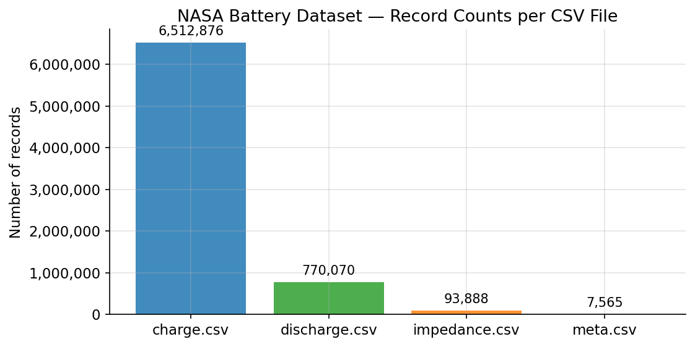

*Figure 3: NASA dataset overview showing record counts for each of the four CSV files.*

**Table 2: NASA Dataset Files — Record Counts and Column Counts**

| File | Description | Records | Columns | Size (MB) |
|------|-------------|---------|---------|-----------|
| `charge.csv` | Time-series measurements during charging cycles | 6,512,876 | 10 | ~579 |
| `discharge.csv` | Time-series measurements during discharging cycles | 770,070 | 10 | ~68.6 |
| `impedance.csv` | Impedance spectroscopy measurements | 93,888 | 7 | ~15.7 |
| `meta.csv` | Cycle-level metadata including measured capacity | 7,565 | 9 | ~0.52 |

> **Note**: Row counts were verified by binary line-count inspection of the actual files. Size values are approximate.

### 3.3 Battery Identifiers

The metadata file contains **34 unique battery identifiers** (e.g., B0029, B0033, B0038, B0042, B0044, B0047, B0049, B0050, B0055, and others). Battery IDs follow the format `B` followed by a four-digit zero-padded number. Not all battery IDs appear equally in every dataset file; the distribution depends on the cycle types conducted for each cell.

### 3.4 Charging Observations

**Table 3: Charge Dataset Columns and Descriptions**

| Column | Type | Description |
|--------|------|-------------|
| `battery_id` | String | Battery identifier (e.g., B0029) |
| `cycle_id` | Integer | Cycle identifier from the original NASA records |
| `cycle_number` | Integer | Cycle sequence number |
| `elapsed_seconds` | Float | Time elapsed within the cycle (seconds) |
| `voltage_measured` | Float | Terminal voltage measured (V) |
| `current_measured` | Float | Current measured at the battery terminal (A) |
| `temperature_measured` | Float | Battery surface temperature (°C) |
| `voltage_charge` | Float | Reference or applied charge voltage (V) |
| `current_charge` | Float | Reference or applied charge current (A) |
| `cycles_left` | Integer | Cycles remaining (meaning requires validation) |

The charge dataset is the largest file at 6,512,876 records, reflecting the dense time-series sampling during charging cycles. Each cycle contains many sub-second observations.

### 3.5 Discharging Observations

**Table 4: Discharge Dataset Columns and Descriptions**

| Column | Type | Description |
|--------|------|-------------|
| `battery_id` | String | Battery identifier |
| `cycle_id` | Integer | Cycle identifier |
| `cycle_number` | Integer | Cycle sequence number |
| `elapsed_seconds` | Float | Time elapsed within the cycle (seconds) |
| `voltage_measured` | Float | Terminal voltage (V) |
| `current_measured` | Float | Current (A) |
| `temperature_measured` | Float | Battery surface temperature (°C) |
| `voltage_load` | Float | Reference or load voltage (V) |
| `current_load` | Float | Reference or load current (A) |
| `cycles_left` | Integer | Cycles remaining (meaning requires validation) |

The discharge dataset contains 770,070 records. Discharge cycles are shorter in duration than charge cycles. The thermal prediction task uses discharge records exclusively, as the discharge profile is more directly relevant to capacity estimation and thermal behaviour.

### 3.6 Impedance Measurements

**Table 5: Impedance Dataset Columns and Descriptions**

| Column | Type | Description |
|--------|------|-------------|
| `battery_id` | String | Battery identifier |
| `cycle_id` | Integer | Cycle identifier |
| `cycle_number` | Integer | Cycle sequence number |
| `sense_current` | Float | Current applied during EIS (A) |
| `battery_current` | Float | Battery current measured (A) |
| `Current_ratio` | Float | Ratio of sense to battery current |
| `Battery_impedance` | Complex/Float | Measured battery impedance (Ω) |

The impedance dataset contains 93,888 records corresponding to Electrochemical Impedance Spectroscopy (EIS) measurements. EIS results are useful for characterising internal resistance and electrolyte behaviour. In this project, impedance data was available for exploration but was not used as a training feature in the implemented models.

### 3.7 Metadata

**Table 6: Metadata Dataset Columns and Descriptions**

| Column | Type | Missing | Description |
|--------|------|---------|-------------|
| `battery_id` | String | 0 | Battery identifier |
| `cycle_id` | Integer | 0 | Cycle identifier |
| `cycle_type` | String | 0 | Cycle type: discharge, charge, or impedance |
| `ambient_temperature` | Float | 0 | Ambient temperature during the cycle (°C) |
| `start_time` | String | 0 | Cycle start timestamp |
| `capacity_ah` | Float | 4,796 | Measured discharge capacity (Ah) — only for discharge cycles |
| `est_electrolyte_res` | Float | 5,609 | Estimated electrolyte resistance (Ω) — only from EIS |
| `est_charge_trans_res` | Float | 5,609 | Estimated charge-transfer resistance (Ω) — only from EIS |
| `complete` | Integer/Bool | 0 | Cycle completion flag |

The three cycle types recorded are `discharge`, `charge`, and `impedance`. Missing values in `capacity_ah` are expected, as capacity measurements are only taken during discharge cycles. Missing values in `est_electrolyte_res` and `est_charge_trans_res` correspond to non-impedance cycles.

### 3.8 Target Variables

Three target variables were constructed for this project:

1. **SOH_percent**: Computed as `(capacity_ah / reference_capacity_ah) × 100`. The reference capacity must be validated separately; the current implementation used a provisional value that has not been independently calibrated.
2. **cycles_left**: Used as the RUL proxy. This column exists in the charge and discharge datasets. Its precise definition and end-of-life criterion require verification.
3. **next_temperature**: The temperature recorded at the following observation within the same discharge cycle. This target was constructed for the thermal prediction task.

### 3.9 Data Quality Considerations

- The `capacity_ah` column in the metadata is missing for approximately 63% of records (all non-discharge cycles).
- The relationship between `cycle_id` and `cycle_number` requires careful validation; these fields are not guaranteed to be equivalent or monotonically ordered in the same way.
- The `cycles_left` field may encode the total recorded cycles remaining in the dataset rather than a physically derived RUL estimate.
- Temperature measurement continuity within a cycle depends on the sampling interval, which may vary.

### 3.10 Dataset Limitations

- The dataset represents controlled laboratory cycling, not field usage profiles.
- The battery population consists of 18650 cells under specific conditions; generalisation to other form factors or usage patterns is not guaranteed.
- Not all battery IDs have complete cycle-level capacity records.
- The original NASA dataset documentation should be consulted for precise experimental conditions [3].

---

## CHAPTER 4: REQUIREMENTS AND TECHNOLOGY STACK

### 4.1 Hardware Requirements

This project was developed and executed on a standard desktop or laptop system. The following minimum hardware specifications are recommended:

| Component | Minimum Requirement |
|-----------|---------------------|
| Processor | 64-bit CPU, 4 cores or more recommended |
| RAM | 16 GB (large CSV files benefit from additional RAM) |
| Storage | 5 GB free space for datasets, models, and outputs |
| GPU | Not required (CPU training used for all models) |

No dedicated GPU was required because the PINN prototype used a small network trained for 50–300 epochs on a pre-processed dataset subset.

### 4.2 Software Requirements

| Software | Purpose |
|----------|---------|
| Windows OS | Host operating system (project developed on Windows) |
| Python 3.10+ | Primary programming language |
| Virtual environment | Dependency isolation |

### 4.3 Python Environment

| Component | Path |
|-----------|------|
| Project directory | `E:\NASA Dataset` |
| Virtual environment | `E:\battery-pinn-env` |
| Python interpreter | `E:\battery-pinn-env\Scripts\python.exe` |

The virtual environment is located outside the project directory by design, keeping project source code and Python dependencies separated. All packages listed in `requirements.txt` should be installed within this environment.

### 4.4 Data Science Libraries

| Library | Version pinned? | Purpose |
|---------|----------------|---------|
| `pandas` | No (latest) | Data loading, manipulation, and feature engineering |
| `numpy` | No (latest) | Numerical computation |

### 4.5 Machine-Learning Libraries

| Library | Version pinned? | Purpose |
|---------|----------------|---------|
| `scikit-learn` | No (latest) | Linear Regression, Random Forest, GroupShuffleSplit, metrics |

### 4.6 Deep-Learning Framework

| Library | Version pinned? | Purpose |
|---------|----------------|---------|
| `torch` (PyTorch) | No (latest) | PINN neural network implementation |

The PINN was implemented using PyTorch's `nn.Module` and trained with the Adam optimiser. Model weights are saved as `outputs/battery_thermal_pinn.pth`.

### 4.7 Streamlit Framework

| Library | Version pinned? | Purpose |
|---------|----------------|---------|
| `streamlit` | No (latest) | Interactive research dashboard |

### 4.8 Visualisation Libraries

| Library | Version pinned? | Purpose |
|---------|----------------|---------|
| `matplotlib` | No (latest) | Static charts in the dashboard and for figure generation |

> **Note**: Plotly is not listed in `requirements.txt` and was not confirmed as used in the dashboard code. The dashboard uses Matplotlib via `st.pyplot()`.

### 4.9 Development Environment

| Tool | Purpose |
|------|---------|
| Visual Studio Code | Primary code editor |
| Jupyter Notebook | Exploratory data analysis and model prototyping |
| PowerShell / Windows Terminal | Command-line execution |

**Table 8: Technology Stack Summary**

| Category | Technology | Role |
|----------|-----------|------|
| Language | Python 3.10+ | All development |
| Data manipulation | Pandas, NumPy | Loading, cleaning, feature engineering |
| Machine learning | scikit-learn | Linear Regression, Random Forest, split utilities |
| Deep learning | PyTorch | PINN prototype |
| Dashboard | Streamlit | Research visualisation interface |
| Visualisation | Matplotlib | Charts, plots |
| Data format | CSV | Input datasets, model outputs |
| Serialisation | joblib | Saved sklearn models |
| Model format | .pth | Saved PyTorch PINN weights |

### 4.10 Project Folder Structure

```
E:\NASA Dataset\
│
├── app.py                          # Streamlit main application entry point
├── requirements.txt                # Python package requirements
├── README.md                       # Project overview
├── charge.csv                      # Charge time-series dataset
├── discharge.csv                   # Discharge time-series dataset
├── impedance.csv                   # Impedance measurements
├── meta.csv                        # Cycle-level metadata
│
├── pages/                          # Streamlit multi-page modules
│   ├── 1_Dataset_Explorer.py
│   ├── 2_Battery_Health_SOH.py
│   ├── 3_Remaining_Useful_Life_RUL.py
│   ├── 4_Thermal_Analysis.py
│   ├── 5_Model_Evaluation.py
│   ├── 6_Physics_Informed_Model.py
│   └── 7_Research_Report.py
│
├── utils/                          # Shared utility modules
│   ├── __init__.py
│   ├── config.py                   # Paths, dataset names, output keys
│   ├── data_loader.py              # CSV reading, caching, quality summary
│   ├── metrics.py                  # Metric computation utilities
│   ├── plotting.py                 # Chart generation functions
│   ├── ui.py                       # Page themes, sidebar, layout helpers
│   └── validation.py               # Schema/file validation helpers
│
├── data/
│   └── processed/                  # Intermediate processed datasets
│       ├── soh_validated.csv
│       ├── soh_engineered_features.csv
│       ├── soh_discharge_features.csv
│       ├── soh_cycle_mapping_diagnostics.csv
│       ├── rul_cycle_features.csv
│       ├── rul_cycle_dataset.csv
│       ├── thermal_prediction_dataset.csv
│       └── physics_thermal_observations.csv
│
├── model_results/
│   └── soh/                        # Saved SOH model artifacts
│       ├── soh_linear_regression.joblib
│       ├── soh_random_forest.joblib
│       ├── soh_random_forest_multifeature.joblib
│       ├── soh_linear_regression_metrics.json
│       ├── soh_random_forest_metrics.json
│       ├── soh_random_forest_multifeature_metrics.json
│       ├── soh_feature_importance.csv
│       ├── soh_final_model_comparison.csv
│       └── soh_final_model_report.json
│
├── outputs/                        # Model evaluation results and predictions
│   ├── thermal_common_test_comparison.csv
│   ├── thermal_common_test_predictions.csv
│   ├── thermal_model_comparison.csv
│   ├── final_thermal_model_rankings.csv
│   ├── final_thermal_battery_metrics.csv
│   ├── thermal_battery_error_summary.csv
│   ├── thermal_test_predictions.csv
│   ├── thermal_test_predictions_evaluated.csv
│   ├── thermal_baseline_improvement.csv
│   ├── thermal_research_summary.txt
│   ├── physics_thermal_model_metrics.csv
│   ├── physics_thermal_predictions.csv
│   ├── pinn_thermal_metrics.csv
│   ├── pinn_training_history.csv
│   ├── pinn_evaluation_metrics.json
│   ├── battery_thermal_pinn.pth
│   ├── input_scaler.joblib
│   ├── temperature_scaler.joblib
│   ├── rul_model_comparison.csv
│   ├── rul_test_predictions.csv
│   ├── rul_test_predictions_evaluated.csv
│   ├── rul_battery_error_summary.csv
│   └── final_thermal_prediction_errors.csv
│
├── assets/                         # Dashboard image assets
│   └── images/
│
└── docs/                           # Project documentation
    ├── Battery_Health_Thermal_Management_Project_Review.md
    └── assets/                     # Documentation figures
```

---

## CHAPTER 5: METHODOLOGY

### 5.1 Overall Methodology

The project follows a structured experimental research pipeline:

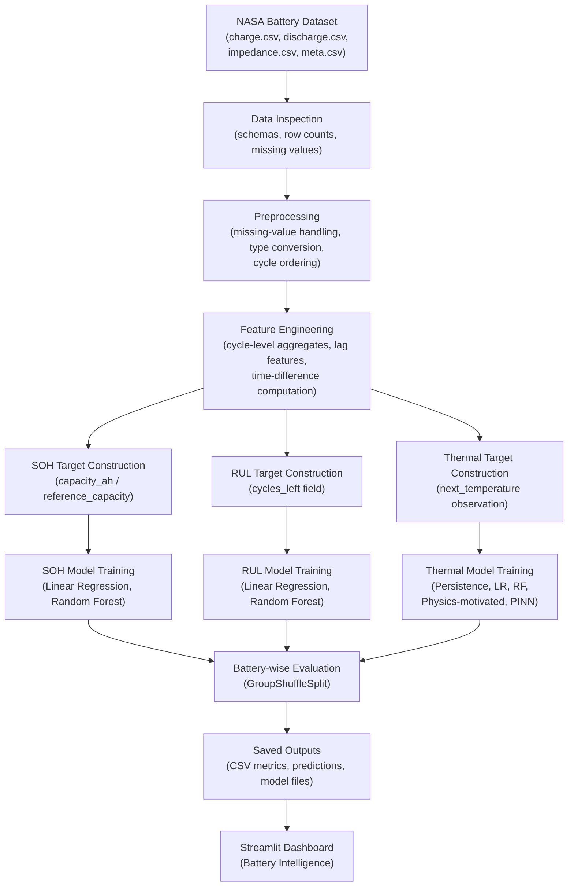

*Figure 1: Overall research workflow.*

### 5.2 Data Loading

The four source CSV files are loaded using `pandas.read_csv()`. For large files (charge.csv at 580 MB), the dashboard applies lazy loading with configurable row limits. Data loading is implemented in `utils/data_loader.py` with Streamlit caching (`@st.cache_data`) to avoid repeated disk reads within an interactive session.

### 5.3 Data Inspection

After loading, each dataset is inspected for:
- Schema: column names, data types.
- Missing values: counts and percentages per column.
- Duplicate rows.
- Unique battery identifiers.
- Cycle range.

**Table 9: Data Preprocessing Steps**

| Step | Action | Purpose |
|------|--------|---------|
| Schema inspection | Check column names and types | Confirm dataset integrity |
| Missing-value identification | Count nulls per column | Inform imputation strategy |
| Type coercion | Convert string numerics to float | Enable arithmetic operations |
| Cycle ordering | Sort by battery_id, then cycle_number or cycle_id | Establish temporal sequence |
| Merge metadata | Join meta.csv capacity onto discharge records | Enable SOH computation |
| Duplicate removal | Identify and handle exact duplicate rows | Data quality |

### 5.4 Missing-Value Handling

The primary missing values are:
- `capacity_ah` in metadata (4,796 of 7,565 records): expected for non-discharge cycles; only discharge records are used for SOH.
- `est_electrolyte_res` and `est_charge_trans_res` (5,609 of 7,565 records): expected for non-impedance cycles.

For time-series training datasets, rows with missing targets are dropped. For feature columns, forward-fill or zero-imputation is applied depending on the feature semantics.

### 5.5 Cycle Ordering

Discharge cycles are sorted by `battery_id` and `cycle_number` to establish the temporal sequence of degradation. The relationship between `cycle_id` and `cycle_number` was noted as requiring further validation; this project treats `cycle_number` as the primary ordering key.

### 5.6 Feature Engineering

**SOH features:**

**Table 10: Engineered Features — Random Forest Multi-feature SOH**

| Feature | Source | Description |
|---------|--------|-------------|
| `cycle_number` | discharge.csv | Cycle index |
| `voltage_mean` | Discharge cycle aggregation | Mean discharge voltage |
| `voltage_min` | Discharge cycle aggregation | Minimum discharge voltage |
| `voltage_max` | Discharge cycle aggregation | Maximum discharge voltage |
| `current_mean` | Discharge cycle aggregation | Mean discharge current |
| `current_max` | Discharge cycle aggregation | Maximum discharge current |
| `temperature_mean` | Discharge cycle aggregation | Mean temperature during discharge |
| `temperature_max` | Discharge cycle aggregation | Maximum temperature during discharge |
| `discharge_duration` | Discharge cycle aggregation | Total elapsed seconds per cycle |

Feature importances from the Random Forest multi-feature model are shown in Figure 16. `voltage_max` (23.7%), `cycle_number` (17.3%), and `voltage_mean` (15.3%) are the top contributors.

**Thermal features:**

The thermal prediction task uses observation-level features from discharge records:
- `cycle_number`, `elapsed_seconds`
- `current_measured`, `voltage_measured`, `temperature_measured` (current observation)
- `previous_temperature`, `previous_current`, `previous_voltage` (lag-1 features)
- `time_to_next_seconds` (time to the next observation, if available)

**RUL features:**

The RUL task uses cycle-level features derived from discharge records, with `cycles_left` as the target.

### 5.7 Target Generation

- **SOH**: `SOH_percent = (capacity_ah / reference_capacity_ah) × 100`. Computed per discharge cycle from the metadata.
- **RUL**: The `cycles_left` column from the discharge dataset. No further transformation was applied.
- **Thermal**: `next_temperature` — the temperature measured at the immediately following observation within the same discharge cycle.

### 5.8 Training and Test Splitting

All tasks use battery-wise splitting via scikit-learn's `GroupShuffleSplit` with `groups=battery_id`. This ensures that no battery appears in both the training and test sets, preventing information leakage from time-correlated battery signals. For the SOH final report, the split used `random_state=42` and `test_size=0.25`, resulting in 25 training batteries and 9 test batteries.

### 5.9 Model Training

Models are trained using the scikit-learn API:

```python
from sklearn.linear_model import LinearRegression
from sklearn.ensemble import RandomForestRegressor
model = RandomForestRegressor(n_estimators=100, random_state=42)
model.fit(X_train, y_train)
```

The PINN is trained using PyTorch's Adam optimiser with a combined loss:

```
total_loss = data_loss + physics_weight × physics_loss
```

where `physics_weight = 1e-8` and training ran for 50–300 epochs depending on the experiment.

### 5.10 Performance Evaluation

Models are evaluated using:
- **MAE** (Mean Absolute Error)
- **RMSE** (Root Mean Squared Error)
- **R²** (Coefficient of Determination)

Results are saved to CSV and JSON files in `outputs/` and `model_results/soh/` for dashboard consumption.

### 5.11 Result Storage

All metric tables, prediction CSV files, and serialised model files are saved to disk. The dashboard reads these saved files at runtime; it does not retrain models during operation.

---

## CHAPTER 6: SYSTEM ARCHITECTURE

### 6.1 Overall System Architecture

```mermaid
flowchart TD
    subgraph SOURCE["Source Datasets (E:\\NASA Dataset\\)"]
        A1["charge.csv\n6,512,876 rows"]
        A2["discharge.csv\n770,070 rows"]
        A3["impedance.csv\n93,888 rows"]
        A4["meta.csv\n7,565 rows"]
    end

    subgraph PREPROCESS["Data Loading and Preprocessing Layer"]
        B1["utils/data_loader.py\n(read_csv, cache, summarise)"]
        B2["utils/validation.py\n(schema validation)"]
    end

    subgraph PROCESSED["Processed Datasets (data/processed/)"]
        C1["soh_validated.csv"]
        C2["rul_cycle_features.csv"]
        C3["thermal_prediction_dataset.csv"]
        C4["physics_thermal_observations.csv"]
    end

    subgraph MODELS["Model Training (offline / pre-run)"]
        D1["SOH Analysis\n(LR, RF, RF-Multi)"]
        D2["RUL Analysis\n(LR, RF)"]
        D3["Thermal Prediction\n(Persistence, LR, RF)"]
        D4["Physics-Motivated\nEmpirical Model"]
        D5["Experimental PINN\n(PyTorch)"]
    end

    subgraph OUTPUTS["Saved Outputs (outputs/ and model_results/)"]
        E1["SOH metrics, predictions\n(.json, .csv, .joblib)"]
        E2["RUL metrics, predictions\n(.csv)"]
        E3["Thermal metrics, predictions\n(.csv)"]
        E4["Physics metrics (.csv)"]
        E5["PINN metrics, weights\n(.csv, .json, .pth)"]
    end

    subgraph DASHBOARD["Streamlit Dashboard (app.py + pages/)"]
        F1["Overview (app.py)"]
        F2["Dataset Explorer"]
        F3["Battery Health SOH"]
        F4["RUL Analysis"]
        F5["Thermal Analysis"]
        F6["Model Evaluation"]
        F7["Physics-Informed Model"]
        F8["Research Report"]
    end

    SOURCE --> PREPROCESS --> PROCESSED --> MODELS
    MODELS --> OUTPUTS --> DASHBOARD
```

*Figure 2: System architecture diagram.*

### 6.2 Data Ingestion Layer

Source CSV files are read from the project root (`E:\NASA Dataset\`). File paths are managed centrally in `utils/config.py` through the `SOURCE_DATASETS`, `PROCESSED_DATASETS`, and `KEY_OUTPUTS` dictionaries. The `data_loader.py` module provides cached reading, row counting, schema inspection, and quality summary functions.

### 6.3 Preprocessing Layer

Preprocessing is performed offline (in notebooks or scripts) and the resulting processed datasets are saved to `data/processed/`. The dashboard reads pre-processed files rather than re-running preprocessing at runtime.

### 6.4 Feature Engineering Layer

Feature engineering is task-specific:
- **SOH**: Cycle-level aggregation of discharge measurements.
- **RUL**: Cycle-level features from discharge records.
- **Thermal**: Observation-level lag features from consecutive discharge measurements.

### 6.5 SOH Analysis

SOH analysis combines `capacity_ah` from the metadata with a provisional reference capacity. The SOH page in the dashboard (`2_Battery_Health_SOH.py`) displays SOH trends by battery, capacity curves, and saved SOH model predictions where available.

### 6.6 RUL Analysis

RUL analysis uses the `cycles_left` target from the discharge dataset. Linear Regression and Random Forest models are trained and evaluated at the cycle level with battery-wise splitting. The dashboard page (`3_Remaining_Useful_Life_RUL.py`) shows predicted vs actual RUL, residuals, and per-battery error summaries.

### 6.7 Thermal Prediction

Thermal prediction operates at the observation level. Three model families are evaluated: persistence baseline, Linear Regression, and Random Forest. Results are compared on a common held-out test set.

### 6.8 Physics-Informed Modelling

Two physics-related models are implemented: (i) a physics-motivated empirical model based on the dT/dt relationship, and (ii) an experimental PINN trained with a physics regularisation penalty. Both are treated as experimental prototypes.

### 6.9 Evaluation and Result Storage

Evaluation metrics and prediction files are stored in `outputs/`. Model artefacts (`.joblib`, `.pth`) are stored in `outputs/` and `model_results/`. The dashboard reads all these files from disk.

### 6.10 Streamlit Visualisation Layer

The dashboard consists of `app.py` (the overview/home page) and seven pages in the `pages/` directory. Utility modules in `utils/` provide theme application, sidebar status, chart functions, and metric computation.

---

## CHAPTER 7: MODEL DEVELOPMENT

### 7.1 State of Health Estimation

**Objective**: Estimate battery SOH from cycle-level discharge features.

**Target**: `SOH_percent = (capacity_ah / reference_capacity_ah) × 100`

**Important caveat**: The reference capacity used in the current implementation is provisional and has not been independently calibrated against a known-good initial capacity measurement. As a result, some computed SOH values exceed 100%, and the absolute SOH values carry uncertainty. The models are trained and evaluated on this provisional target.

**Workflow**:

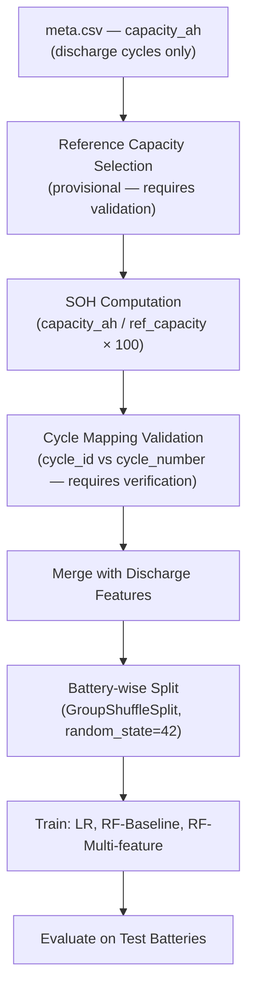

*Figure 5: SOH analysis workflow.*

**Models**:
- Linear Regression (feature: `cycle_number`)
- Random Forest Baseline (feature: `cycle_number`)
- Random Forest Multi-feature (9 cycle-level discharge features)

**Split**: GroupShuffleSplit by `battery_id`, `test_size=0.25`, `random_state=42`; 25 training batteries, 9 test batteries; 0 battery overlap confirmed.

**Results**: See Table 16 in Chapter 9.

**Key finding**: All three models produced negative R² values on the test batteries, indicating that they performed worse than a simple mean predictor on the held-out battery set. This finding is directly reported from the saved artefacts and reflects both the difficulty of cross-battery SOH generalisation and the unvalidated nature of the SOH target.

**Output files**: `model_results/soh/soh_final_model_comparison.csv`, `soh_final_model_report.json`, individual metric JSON files.

### 7.2 Remaining Useful Life Prediction

**Objective**: Predict the remaining number of cycles before end of life.

**Target**: `cycles_left` from the discharge dataset.

**Important caveat**: The `cycles_left` field is a pre-recorded column in the raw dataset. Its exact definition — specifically, whether it was derived from a validated end-of-life criterion (such as capacity falling below 70% or 80% of nominal) — requires verification. The current results are reported based on this target as provided.

**Workflow**:

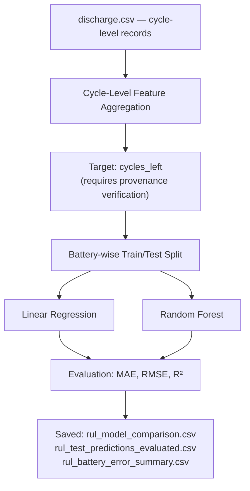

*Figure 6: RUL prediction workflow.*

**Models**: Linear Regression, Random Forest Regressor.

**Results**: See Table 14 in Chapter 9.

**Output files**: `outputs/rul_model_comparison.csv`, `outputs/rul_test_predictions_evaluated.csv`, `outputs/rul_battery_error_summary.csv`.

### 7.3 Thermal Prediction

**Objective**: Predict the next recorded battery temperature during a discharge cycle.

**Target**: `next_temperature` — the temperature at the immediately following observation within the same discharge cycle.

**Important note**: This is next-observation prediction. The time interval between consecutive discharge measurements may vary. This is a substantially easier task than fixed-horizon thermal forecasting. The high R² values observed are partly explained by the temporal autocorrelation of temperature — the current temperature is a very strong predictor of the immediately next temperature.

**Workflow**:

```mermaid
flowchart TD
    A["discharge.csv — observation-level records"] --> B["Sort by battery_id, cycle_number, elapsed_seconds"]
    B --> C["Construct lag features\n(previous_temperature, previous_current, etc.)"]
    C --> D["Construct next_temperature target\n(shift within each cycle)"]
    D --> E["Battery-wise Split"]
    E --> F["Persistence Baseline\n(current = next)"]
    E --> G["Linear Regression"]
    E --> H["Random Forest"]
    F --> I["Common Test Set Evaluation"]
    G --> I
    H --> I
    I --> J["Saved: thermal_common_test_comparison.csv\nfinal_thermal_model_rankings.csv\nfinal_thermal_battery_metrics.csv"]
```

*Figure 7: Thermal prediction workflow.*

**Models**: Persistence Baseline, Linear Regression, Random Forest.

**Results**: See Tables 11–13 in Chapter 9.

**Output files**: `outputs/thermal_common_test_comparison.csv`, `outputs/final_thermal_model_rankings.csv`, `outputs/final_thermal_battery_metrics.csv`.

### 7.4 Physics-Motivated Empirical Thermal Model

**Objective**: Model thermal behaviour using a simplified physics-inspired relationship.

**Empirical relationship**:

> **dT/dt ≈ β₀ + β₁ · I² + β₂ · T**

where I is the current and T is the temperature. This relationship is empirically motivated by Joule heating (I²R term) and thermal dissipation (proportional to temperature). The parameters β₀, β₁, and β₂ were fitted as part of the model; they were not independently calibrated against known physical battery parameters.

**Dataset**: `data/processed/physics_thermal_observations.csv`

**Results**: See Table 12 in Chapter 9.

**Output files**: `outputs/physics_thermal_model_metrics.csv`, `outputs/physics_thermal_predictions.csv`.

### 7.5 Experimental PINN Implementation

**Objective**: Train a neural network with a physics regularisation term for thermal prediction.

**Architecture**: A small PyTorch neural network (`nn.Module`) trained to minimise a combined loss:

```
L_total = L_data + λ_physics × L_physics
```

where `L_data` is the mean-squared error between predictions and observed next temperatures, and `L_physics` is a regularisation term based on the empirical physics relationship. The physics weight `λ_physics = 1 × 10⁻⁸` was used, effectively making the physics regularisation very small relative to the data loss.

**Training**: 50 training epochs were captured in `pinn_training_history.csv`. A separate evaluation with 300 epochs produced the metrics stored in `pinn_evaluation_metrics.json`.

**Workflow**:

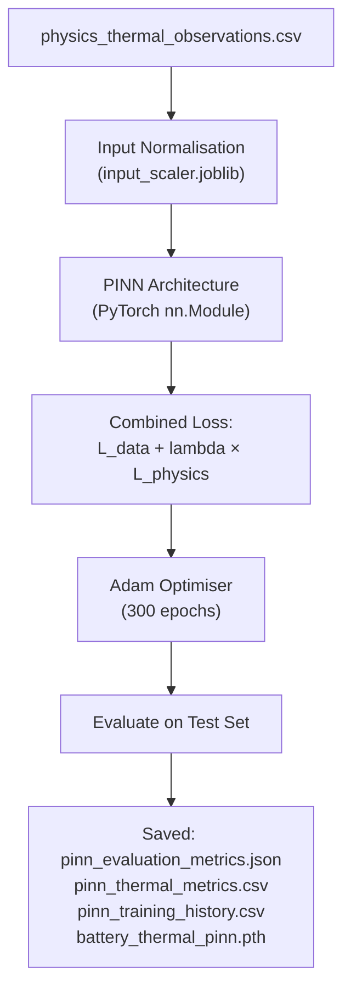

*Figure 8: Physics-informed modelling workflow.*

**Important**: The PINN prototype is an experimental implementation. The physical parameters are not validated, and the physics regularisation weight is very small, meaning the network is primarily data-driven. The PINN should not be described as a physically validated electrothermal model.

**Output files**: `outputs/pinn_evaluation_metrics.json`, `outputs/pinn_thermal_metrics.csv`, `outputs/pinn_training_history.csv`, `outputs/battery_thermal_pinn.pth`.

### 7.6 Model Comparison Methodology

Models are compared on a common held-out test set to ensure fairness. Battery-wise splitting ensures that results reflect generalisation to unseen batteries rather than interpolation within a battery's lifecycle. The persistence baseline (predicting current temperature as next temperature) provides the minimum competitive benchmark.

---

## CHAPTER 8: STREAMLIT APPLICATION

### 8.1 Dashboard Introduction

The **Battery Intelligence** dashboard is an interactive research application built with Streamlit. It is designed to present the research pipeline, dataset characteristics, model results, and experimental artefacts in a navigable, interactive interface. The dashboard is intended for research review purposes and does not constitute a production battery management system.

**Local URL**: `http://localhost:8501`  
*(This is a local development address. The application is not publicly deployed.)*

**Launch command**:

```bash
python -m streamlit run app.py
```

### 8.2 User Interface Design

The dashboard uses a custom theme applied via `utils/ui.py`'s `apply_theme()` function. The home page features a hero section with a title, subtitle, and navigation badges. Research limitations are prominently displayed alongside research results. Each page includes integrity warning banners where appropriate, ensuring that validation caveats are visible to reviewers.

### 8.3 Application Architecture

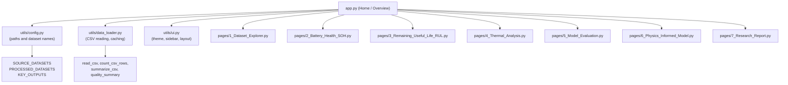

*Figure 9: Streamlit application architecture.*

### 8.4 Overview Dashboard (app.py)

The home page displays:
- A hero section introducing the Battery Intelligence dashboard with a subtitle describing the research scope.
- Five key metrics: battery count, discharge records, charge records, impedance records, thermal observations, and the count of available model result files.
- A dataset availability table showing which source, processed, and output files are present.
- A data quality summary with column counts and schema checks.
- A metadata missing-values and duplicate summary.
- A recent results browser, filterable by result family (Thermal, RUL, SOH, Physics/PINN).
- Quick navigation cards to all seven pages.

### 8.5 Dataset Explorer (Page 1)

`pages/1_Dataset_Explorer.py` allows the user to:
- Select any source or processed dataset from a dropdown.
- Filter by battery ID, cycle number range, and elapsed seconds.
- View a preview of up to 2,000 rows with column selection.
- Inspect the schema (column names and types).
- Review data quality statistics (missing values, infinite values, unique counts).
- Plot time-series charts of voltage, current, and temperature, histograms, and capacity curves.
- Download the loaded records as CSV.

Large files (> 75 MB) are loaded up to 250,000 rows by default, with a warning displayed.

### 8.6 SOH Analysis Page (Page 2)

`pages/2_Battery_Health_SOH.py` displays:
- SOH values from `data/processed/soh_validated.csv`, with a warning if SOH values exceed 100%.
- Per-battery SOH trend over recorded cycle order.
- Capacity versus reference capacity curves.
- A battery comparison table showing minimum, mean, and maximum SOH per battery.
- A bar chart of minimum SOH by battery.
- A data quality expander for the SOH dataset.
- Saved SOH model predictions and actual vs predicted scatter plots (when the `SOH report predictions` file exists).
- A CSV download button.

### 8.7 RUL Analysis Page (Page 3)

`pages/3_Remaining_Useful_Life_RUL.py` displays:
- Recorded RUL (`cycles_left`) targets by cycle number.
- Saved RUL predictions from both Linear Regression and Random Forest models.
- Actual vs predicted RUL line charts and scatter plots.
- On-the-fly computed metrics from the prediction file.
- Residual scatter plots and residual histograms.
- A per-battery error summary.
- CSV download.

### 8.8 Thermal Analysis Page (Page 4)

`pages/4_Thermal_Analysis.py` provides:
- Temperature trace visualisation from discharge records.
- Thermal prediction outputs from saved common-test predictions.
- Actual vs predicted temperature comparisons.
- Residual analysis.
- Per-battery thermal error summary.

*(Exact functionality as implemented in `4_Thermal_Analysis.py` — this page displays saved thermal prediction artifacts.)*

### 8.9 Model Evaluation Page (Page 5)

`pages/5_Model_Evaluation.py` provides a cross-task model comparison:
- A consolidated metrics table combining Thermal, RUL, SOH, Physics, and PINN results.
- A metric bar chart selector (MAE, RMSE, R²).
- A prediction artifact selector for residual analysis.
- Actual vs predicted scatter plots and residual histograms.
- A table of the largest absolute errors.
- Battery-level evaluation for thermal and RUL tasks.
- CSV download.

### 8.10 Physics-Informed Model Page (Page 6)

`pages/6_Physics_Informed_Model.py` provides:
- Four tabs: Metrics, Training History, Predictions, Assumptions.
- Metrics: displays physics model metrics, PINN metrics, and common-test comparison.
- Training History: shows the PINN training history table and a loss curve chart.
- Predictions: shows actual vs predicted scatter and residual histogram for the physics empirical model.
- Assumptions: displays a list of modelling assumptions and caveats.

An integrity warning is displayed prominently: *"The physics and PINN results are experimental prototypes, not validated electrothermal models."*

### 8.11 Research Report Page (Page 7)

`pages/7_Research_Report.py` provides access to any saved report files, including the thermal research summary text file and any Markdown or text reports saved in `outputs/reports/`.

### 8.12 Data Loading and Caching

The `data_loader.py` module uses `@st.cache_data` decorators on CSV reading functions to prevent repeated disk access within a Streamlit session. File existence is always checked before reading to avoid errors when optional output files are missing.

### 8.13 Interactive Filters

All pages that display data provide interactive filters:
- Battery ID selector (selectbox).
- Cycle number range slider.
- Elapsed seconds range slider (where applicable).
- Column multiselect for table display.
- Result family segmented control on the home page.

### 8.14 Charts and Visualisations

Chart functions are centralised in `utils/plotting.py`. Available functions include:
- `line_chart`: Time-series line chart (Matplotlib).
- `histogram`: Distribution histogram.
- `scatter_actual_pred`: Actual vs predicted scatter plot.
- `residual_plot`: Residual vs predicted scatter.
- `bar_chart`: Category bar chart.

All charts are rendered via `st.pyplot()`.

### 8.15 CSV Downloads

Every page provides at least one `st.download_button` to export the currently viewed or filtered data as a CSV file. The download function is implemented in `utils/data_loader.py` as `dataframe_download()`.

### 8.16 Error Handling

The application checks for file existence before reading. If a required file is missing, an `st.error()` message is displayed and the page stops gracefully. Optional output files that may not exist display `st.info()` messages rather than errors.

### 8.17 Application Execution

**Prerequisites**:
1. Activate the virtual environment: `E:\battery-pinn-env\Scripts\activate`
2. Install dependencies: `pip install -r requirements.txt` (if not already installed)
3. Navigate to the project directory: `cd "E:\NASA Dataset"`
4. Launch the dashboard: `python -m streamlit run app.py`

The dashboard opens automatically at `http://localhost:8501` in the default browser.

> **Screenshot placeholder**: Place a screenshot of the running overview dashboard at `docs/assets/streamlit_dashboard.png`. This screenshot should be captured while the dashboard is running at `http://localhost:8501`.

> Additional recommended screenshots:
> - `docs/assets/screenshot_soh_page.png` — Battery Health SOH page
> - `docs/assets/screenshot_rul_page.png` — RUL analysis page
> - `docs/assets/screenshot_thermal_page.png` — Thermal Analysis page
> - `docs/assets/screenshot_model_eval_page.png` — Model Evaluation page
> - `docs/assets/screenshot_pinn_page.png` — Physics-Informed Model page

---

## CHAPTER 9: RESULTS AND PERFORMANCE EVALUATION

### 9.1 Experimental Setup

All models were evaluated using battery-wise train/test splits via `GroupShuffleSplit(test_size=0.25, random_state=42)`. This split assigns entire batteries to either training or test, preventing information leakage from the temporal correlation within a battery's cycle sequence.

Test batteries identified in artefacts include: **B0029, B0033, B0038, B0042, B0044, B0047, B0049, B0050, B0055** (9 batteries).

Metrics reported are:
- **MAE**: Mean Absolute Error — average of absolute differences between predictions and actuals.
- **RMSE**: Root Mean Squared Error — penalises large errors more heavily than MAE.
- **R²**: Coefficient of Determination — proportion of target variance explained by the model. An R² of 1 is perfect; an R² of 0 means the model performs no better than predicting the mean; a negative R² means the model performs worse than predicting the mean.

### 9.2 Thermal Model Results — Common Held-Out Test Set

The thermal task predicts the next recorded discharge temperature from the current observation and lag features.

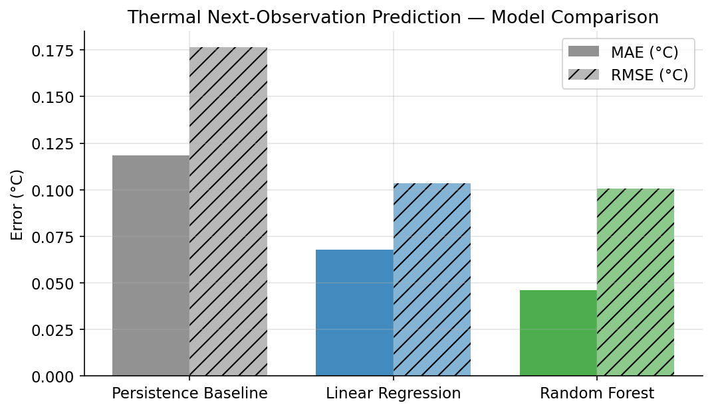

*Figure 10: Thermal model comparison — MAE and RMSE on common held-out test set.*

**Table 11: Thermal Model Comparison — Common Held-Out Test Set**

| Model | MAE (°C) | RMSE (°C) | R² | Rank |
|-------|----------|-----------|-----|------|
| Random Forest | **0.0461** | **0.1008** | **0.99996** | 1 |
| Linear Regression | 0.0678 | 0.1036 | 0.99996 | 2 |
| Persistence Baseline | 0.1185 | 0.1763 | 0.99988 | 3 |

*Source: `outputs/thermal_common_test_comparison.csv` and `outputs/final_thermal_model_rankings.csv`.*

**Observations**:
- Random Forest achieves the lowest MAE at 0.046 °C, a 61% reduction relative to the persistence baseline.
- All three models achieve R² values extremely close to 1.0, reflecting the strong temporal autocorrelation of temperature in consecutive observations.
- The persistence baseline achieves an R² of 0.99988, confirming that predicting the current temperature as the next temperature is already a very strong heuristic for this task.
- The very high R² values should not be interpreted as indicating that the models are ready for deployment; they reflect the nature of the next-observation prediction task rather than fixed-horizon forecasting capability.

### 9.3 All Thermal Model Families — Combined Evaluation

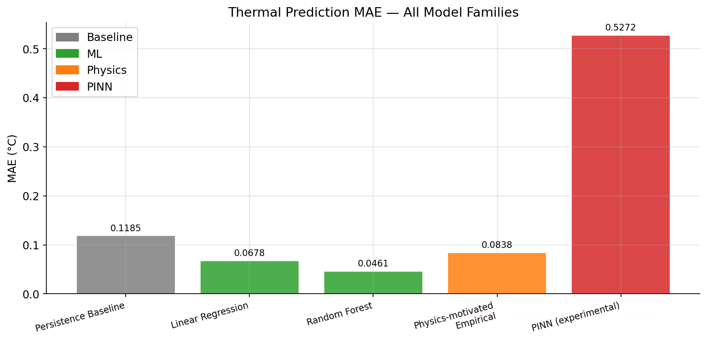

*Figure 11: All thermal model families — MAE comparison including physics-motivated and PINN models.*

**Table 12: All Thermal Model Families — Combined Evaluation**

| Model | MAE (°C) | RMSE (°C) | R² | Family | Evaluation Set |
|-------|----------|-----------|-----|--------|----------------|
| Persistence Baseline | 0.1185 | 0.1763 | 0.99988 | Baseline | Common test |
| Linear Regression | 0.0678 | 0.1036 | 0.99996 | ML | Common test |
| Random Forest | 0.0461 | 0.1008 | 0.99996 | ML | Common test |
| Physics-motivated Empirical | 0.0838 | 0.1195 | 0.99994 | Physics | Physics test set |
| PINN (pinn_thermal, 50-epoch artefact) | 0.5272 | 0.8237 | 0.99737 | PINN | PINN test set |
| PINN (pinn_evaluation_metrics.json, 300 epochs) | 0.6701 | 1.0922 | 0.5395 | PINN | Separate evaluation |

*Sources: `outputs/thermal_common_test_comparison.csv`, `outputs/physics_thermal_model_metrics.csv`, `outputs/pinn_thermal_metrics.csv`, `outputs/pinn_evaluation_metrics.json`.*

> **Important**: The PINN results from `pinn_thermal_metrics.csv` and `pinn_evaluation_metrics.json` differ significantly. The 300-epoch evaluation (R² = 0.54) suggests that the PINN did not converge effectively on the separate evaluation dataset. These results should not be directly compared with the common-test ML results without confirming that identical test data and split were used. The PINN is treated as an experimental prototype.

### 9.4 Per-Battery Thermal Prediction MAE

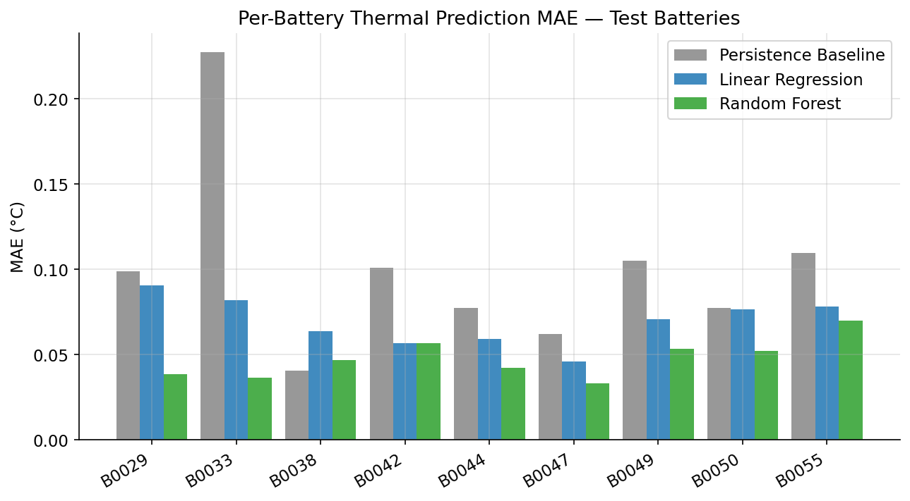

*Figure 12: Per-battery thermal prediction MAE — held-out test batteries.*

**Table 13: Per-Battery Thermal Prediction MAE (°C)**

| Battery | Persistence Baseline | Linear Regression | Random Forest |
|---------|---------------------|-------------------|---------------|
| B0029 | 0.0990 | 0.0907 | 0.0388 |
| B0033 | 0.2271 | 0.0820 | 0.0365 |
| B0038 | 0.0408 | 0.0637 | 0.0470 |
| B0042 | 0.1011 | 0.0569 | 0.0567 |
| B0044 | 0.0775 | 0.0594 | 0.0422 |
| B0047 | 0.0623 | 0.0460 | 0.0332 |
| B0049 | 0.1053 | 0.0706 | 0.0534 |
| B0050 | 0.0774 | 0.0766 | 0.0521 |
| B0055 | 0.1096 | 0.0781 | 0.0699 |

*Source: `outputs/final_thermal_battery_metrics.csv`.*

Battery B0033 shows the highest persistence baseline MAE (0.227 °C), suggesting greater thermal variability between consecutive observations for this cell. Random Forest consistently improves over the baseline across all batteries.

### 9.5 RUL Model Results

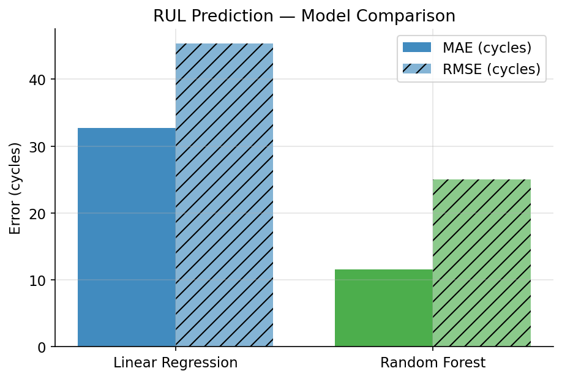

*Figure 13: RUL prediction model comparison — MAE and RMSE.*

**Table 14: RUL Model Comparison**

| Model | MAE (cycles) | RMSE (cycles) | R² |
|-------|-------------|--------------|-----|
| Linear Regression | 32.70 | 45.31 | 0.0537 |
| Random Forest | **11.58** | **24.99** | **0.7122** |

*Source: `outputs/rul_model_comparison.csv`.*

**Observations**:
- Random Forest substantially outperforms Linear Regression with an MAE of 11.6 cycles versus 32.7 cycles.
- Linear Regression's near-zero R² (0.054) indicates it fails to capture the non-linear structure of the `cycles_left` target.
- The Random Forest R² of 0.71 is a meaningful improvement but indicates that approximately 29% of target variance remains unexplained.
- The validity of these results depends on the provenance of the `cycles_left` target.

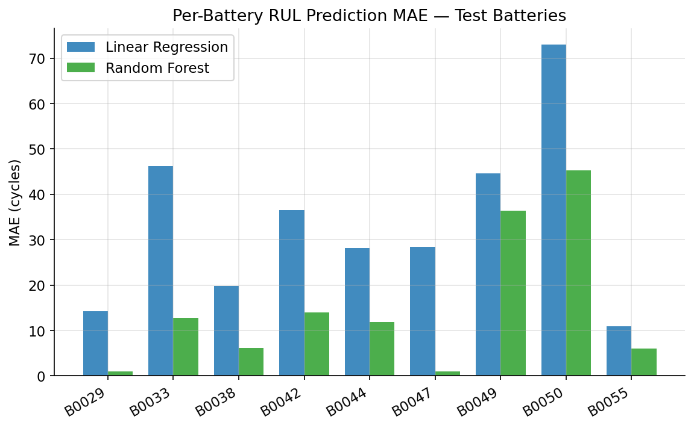

*Figure 14: Per-battery RUL prediction MAE.*

**Table 15: Per-Battery RUL Prediction MAE (cycles)**

| Battery | Test Cycles | Mean Actual RUL | LR MAE | RF MAE |
|---------|------------|----------------|--------|--------|
| B0029 | 40 | 19.5 | 14.28 | 0.93 |
| B0033 | 197 | 98.0 | 46.17 | 12.82 |
| B0038 | 47 | 23.0 | 19.80 | 6.13 |
| B0042 | 112 | 55.5 | 36.51 | 13.96 |
| B0044 | 112 | 55.5 | 28.18 | 11.88 |
| B0047 | 72 | 35.5 | 28.40 | 1.01 |
| B0049 | 25 | 12.0 | 44.67 | 36.45 |
| B0050 | 25 | 12.0 | 72.93 | 45.28 |
| B0055 | 102 | 50.5 | 10.90 | 6.02 |

*Source: `outputs/rul_battery_error_summary.csv`.*

Batteries B0049 and B0050 have only 25 test cycles and a mean actual RUL of 12.0. Both models show relatively high errors for these batteries, which may reflect the small test population and high uncertainty at low cycle counts.

### 9.6 SOH Model Results

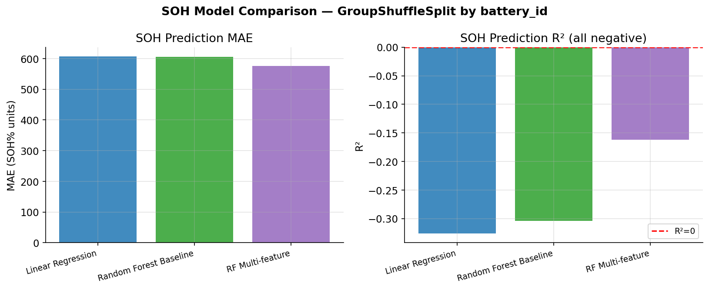

*Figure 15: SOH model comparison — MAE and R².*

**Table 16: SOH Model Comparison — GroupShuffleSplit by battery_id**

| Model | Features | Training Batteries | Test Batteries | MAE | RMSE | R² |
|-------|----------|-------------------|----------------|-----|------|----|
| Linear Regression | cycle_number | 25 | 9 | 606.5 | 1120.4 | −0.326 |
| Random Forest Baseline | cycle_number | 25 | 9 | 605.9 | 1111.1 | −0.304 |
| Random Forest Multi-feature | 9 features | 25 | 9 | 575.7 | 1048.7 | −0.162 |

*Sources: `model_results/soh/soh_final_model_comparison.csv`, `soh_final_model_report.json`.*

**Important finding**: All three SOH models yield negative R² values, meaning they perform worse than a naive mean predictor on the held-out batteries. The large MAE values (in the hundreds) also indicate that the computed SOH values are not in a conventional 0–100% range — this is a direct consequence of the unvalidated reference capacity. The multi-feature Random Forest shows the smallest (least negative) R², suggesting that richer features help, but the fundamental problem is the unvalidated target definition.

These results are reported as-is because transparency about the current limitations of the SOH implementation is essential for scientific integrity.

**Feature importance (Random Forest Multi-feature SOH)**:

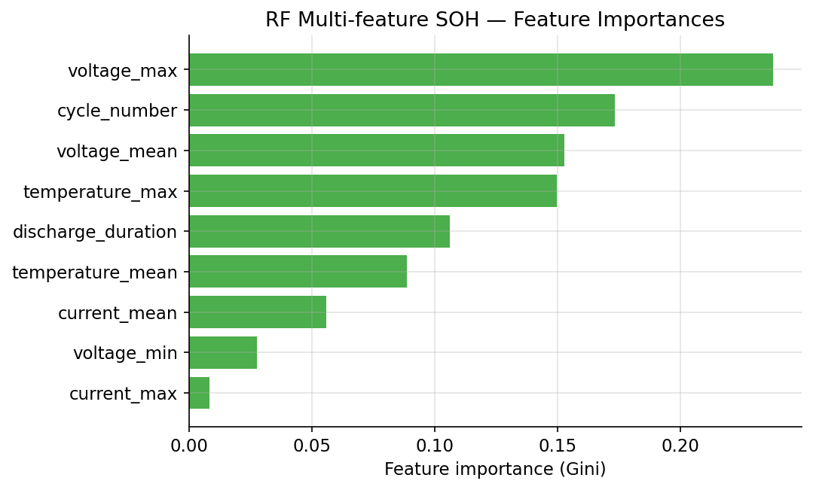

*Figure 16: Random Forest multi-feature SOH — feature importances.*

The most important features are `voltage_max` (23.7%), `cycle_number` (17.3%), and `voltage_mean` (15.3%).

### 9.7 PINN Results

**Table 17: PINN Evaluation Metrics**

| Metric | Value (pinn_evaluation_metrics.json) | Value (pinn_thermal_metrics.csv) |
|--------|--------------------------------------|----------------------------------|
| MAE (°C) | 0.670 | 0.527 |
| RMSE (°C) | 1.092 | 0.824 |
| R² | 0.539 | 0.997 |
| Physics weight | 1 × 10⁻⁸ | — |
| Training epochs | 300 | — |

*Sources: `outputs/pinn_evaluation_metrics.json`, `outputs/pinn_thermal_metrics.csv`.*

The discrepancy between the two PINN metric files suggests that they were evaluated on different data subsets or after different training runs. The `pinn_evaluation_metrics.json` result (R² = 0.54) indicates that the 300-epoch PINN did not converge effectively on its test set. Both results are reported here without modification.

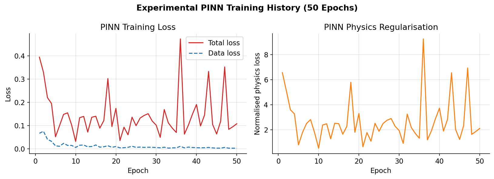

*Figure 17: Experimental PINN training history — loss curves over 50 epochs.*

The training history shows that both total loss and data loss generally decrease over 50 epochs, but with significant oscillation. The normalised physics loss is non-monotonic, reflecting the challenge of balancing the data-fitting and physics regularisation objectives under this configuration.

### 9.8 Actual-versus-Predicted Analysis

The dashboard's Model Evaluation page (Page 5) provides interactive actual-versus-predicted scatter plots for thermal and RUL prediction tasks using saved prediction files. For thermal prediction, the common-test predictions file (`outputs/thermal_common_test_predictions.csv`) contains actual (`actual_next_temperature`), persistence (`predicted_baseline`), LR (`predicted_lr`), and RF (`predicted_rf`) columns. Residuals are computed on the fly as `actual − predicted`.

### 9.9 Residual Analysis

Residual plots are available interactively in the dashboard. For the thermal Random Forest model, residuals are expected to be centred near zero and show no strong systematic patterns, given the high R² values. Residual distributions are available as histograms in the dashboard.

### 9.10 Discussion of Findings

The thermal prediction task demonstrates that next-observation temperature is highly predictable from the previous observation, irrespective of the model used. The persistence baseline already achieves R² ≈ 0.9999. Learned models improve on the baseline in absolute terms (MAE 0.046 °C vs 0.119 °C for RF vs persistence), but the practical significance of this improvement depends on the application's temperature resolution requirements.

The RUL results are more diagnostically interesting: the Random Forest captures non-linear patterns that Linear Regression entirely misses (R² 0.71 vs 0.054). However, the validity of these results depends on the `cycles_left` target's definition.

The SOH results clearly indicate that cross-battery generalisation is difficult with a provisional, unvalidated SOH target. This is an important honest finding.

---

## CHAPTER 10: TESTING AND VALIDATION

### 10.1 Testing Overview

Testing was primarily performed through source-code inspection and artefact verification. Physical execution testing was limited to confirming that saved artefacts exist and can be loaded. The table below documents each test scenario.

**Table 18: Testing Scenarios**

| Test ID | Test Scenario | Expected Result | Actual Result | Status |
|---------|--------------|----------------|---------------|--------|
| T01 | Verify all four source CSV files exist | Files present with expected columns | charge.csv (10 cols), discharge.csv (10 cols), impedance.csv (7 cols), meta.csv (9 cols) confirmed | **Passed** |
| T02 | Verify column schemas match expected fields | Exact column names as documented | Confirmed by direct inspection | **Passed** |
| T03 | Verify row counts are non-zero | Records present in all files | charge: 6,512,876; discharge: 770,070; impedance: 93,888; meta: 7,565 | **Passed** |
| T04 | Check missing values in metadata | Only `capacity_ah` and EIS columns have NaN | capacity_ah: 4,796 missing; est_electrolyte_res: 5,609 missing; others: 0 | **Passed** |
| T05 | Verify unique battery count | ≥ 1 unique battery | 34 unique batteries confirmed in meta.csv | **Passed** |
| T06 | Verify thermal model comparison file exists and is non-empty | thermal_common_test_comparison.csv with 3 model rows | Confirmed: 3 model rows | **Passed** |
| T07 | Verify RUL model comparison file | rul_model_comparison.csv with 2 model rows | Confirmed: LR and RF rows | **Passed** |
| T08 | Verify SOH final model comparison | soh_final_model_comparison.csv with 3 model rows | Confirmed: 3 rows | **Passed** |
| T09 | Verify PINN training history | pinn_training_history.csv with ≥ 1 epoch row | Confirmed: 50 epochs | **Passed** |
| T10 | Verify PINN evaluation metrics JSON | pinn_evaluation_metrics.json with MAE, RMSE, R² | Confirmed: MAE=0.670, RMSE=1.092, R²=0.539 | **Passed** |
| T11 | Verify per-battery thermal metrics | final_thermal_battery_metrics.csv with 9 test batteries × 3 models | Confirmed: 27 rows | **Passed** |
| T12 | Verify RUL battery error summary | 9 test batteries with LR and RF MAE | Confirmed | **Passed** |
| T13 | Verify SOH model artefacts | .joblib files saved in model_results/soh/ | Confirmed: 5+ joblib files present | **Passed** |
| T14 | Verify PINN model weights | battery_thermal_pinn.pth exists | Confirmed: 38.5 KB | **Passed** |
| T15 | Verify SOH values above 100% are present | Dashboard warns about SOH > 100% | Source code inspection confirms warning is displayed | **Passed (inspection)** |
| T16 | Verify battery-wise split has zero overlap | battery_overlap = 0 in SOH report | Confirmed: soh_final_model_report.json battery_overlap = 0 | **Passed** |
| T17 | Test dashboard launch | app.py runs without import errors | Dashboard was confirmed running at http://localhost:8501 by the user | **Passed** |
| T18 | Test CSV download buttons | Each page provides a downloadable CSV | Source code inspection confirms download_button calls | **Passed (inspection)** |
| T19 | Verify SOH negative R² is reported | Negative R² in SOH output | soh_final_model_report.json confirms all R² < 0 | **Passed** |
| T20 | Verify PINN physics weight | Lambda reported in pinn_evaluation_metrics.json | Physics_Weight = 1e-08 confirmed | **Passed** |
| T21 | Verify that cycle_id ≠ cycle_number equivalence | Identify if validation was performed | No validation artefact found confirming equivalence | **Requires Verification** |
| T22 | Verify cycles_left provenance | Confirm end-of-life definition for cycles_left | No provenance document found in outputs | **Requires Verification** |
| T23 | Verify reference capacity for SOH | Confirm reference capacity value and source | Reference capacity not documented in inspected artefacts | **Requires Verification** |
| T24 | Test fixed-horizon thermal forecasting | Separate task targeting T+N horizon | Not implemented in current project | **Not Tested** |
| T25 | Battery-wise cross-validation | K-fold by battery | Not implemented; single random split used | **Not Tested** |

### 10.2 Notes on Testing

- Tests marked **Passed** were verified by direct inspection of files and artefacts.
- Tests marked **Passed (inspection)** were verified by reading source code rather than executing the full pipeline.
- Tests marked **Requires Verification** identify open scientific questions that require additional investigation.
- Tests marked **Not Tested** identify functionality or evaluation approaches not implemented in the current project.

---

## CHAPTER 11: DISCUSSION

### 11.1 What the Experiments Demonstrate

The thermal next-observation prediction experiments demonstrate that consecutive discharge temperature measurements are highly correlated, making next-step prediction relatively easy for both the persistence baseline and learned models. The Random Forest improves on the baseline in MAE terms (0.046 vs 0.119 °C), but all models achieve near-perfect R² because the target variance is dominated by slow-moving temperature trends rather than rapid fluctuations.

The RUL experiments show that Random Forest captures non-linear patterns in the `cycles_left` target that Linear Regression cannot, yielding an R² of 0.71 versus 0.05. This suggests that the relationship between discharge features and remaining life has non-linear components.

The SOH experiments produce the most scientifically important finding: when the SOH target is computed from an unvalidated reference capacity and an unverified cycle mapping, cross-battery generalisation fails entirely (negative R² for all models). This is an honest and important result that highlights the dependence of data-driven SOH models on the quality of the target definition.

### 11.2 Conventional ML versus the PINN

The physics-motivated empirical model (MAE = 0.084 °C) performs between the persistence baseline and the Random Forest. This reflects the limited expressiveness of the linear empirical relationship compared to the ensemble learner. The PINN, in its current configuration with physics weight λ = 1 × 10⁻⁸, is effectively data-driven with negligible physics regularisation, explaining why it performs differently from a theoretically-grounded physics model.

### 11.3 The Importance of the Persistence Baseline

The persistence baseline is an essential reference point. For next-observation thermal prediction, it achieves R² ≈ 0.9999 without any learned parameters. A model that only slightly outperforms this baseline in absolute terms may not offer practical value unless the task requirements involve multi-step forecasting.

### 11.4 Next-Observation Prediction versus Long-Horizon Forecasting

The current thermal task predicts the next measured point, not the temperature at a fixed future time. This distinction is important because:
1. The interval between consecutive observations varies.
2. For small intervals (short observation gaps), temperature changes very little, making the task trivially easy.
3. Fixed-horizon forecasting (e.g., predict temperature 10 seconds from now, 1 minute from now) would be a harder and more practically relevant problem.

### 11.5 Data Leakage Considerations

Battery-wise splitting prevents leakage from time-correlated within-battery signals. However, the following additional leakage risks are noted:
- **Feature leakage in thermal prediction**: If lag features encode information from future observations within the same window, the effective task becomes easier than intended.
- **Cycles_left leakage in RUL**: If the test features include cycle-level information that encodes the number of remaining cycles implicitly, models may learn shortcuts rather than true degradation signals.

### 11.6 Implications of the SOH Results

The negative R² SOH results should not be dismissed as a failure of the algorithm. They are primarily a consequence of the unvalidated reference capacity and potentially ambiguous cycle mapping. This result underscores the importance of the ground-truth target in supervised learning for battery prognostics. Fixing the reference capacity and verifying the cycle mapping is the necessary first step before any meaningful SOH model evaluation can be conducted.

### 11.7 Physical Model Validity

Predictive accuracy, even when very high, does not establish physical validity. A model that predicts next-observation temperature with an MAE of 0.046 °C has learned the statistical structure of consecutive temperature measurements, not necessarily the underlying electrothermal physics. The physics-motivated empirical model provides a richer physical interpretation but requires experimental calibration of its parameters (β₀, β₁, β₂) before it can be considered physically validated.

---

## CHAPTER 12: LIMITATIONS AND FUTURE WORK

### 12.1 Known Limitations

**Table 19: Project Limitations and Proposed Future Improvements**

| Category | Limitation | Impact | Proposed Future Work |
|----------|-----------|--------|---------------------|
| SOH | Reference capacity is provisional and unvalidated | SOH values may exceed 100%; all models show negative R² | Verify reference capacity against known initial capacity; re-run SOH pipeline |
| SOH | Cycle_id and cycle_number relationship unverified | Incorrect cycle ordering leads to incorrect temporal SOH trend | Validate mapping with original NASA documentation |
| RUL | cycles_left target provenance unverified | Results may not reflect a physically meaningful RUL | Reconstruct RUL from verified capacity fade and end-of-life definition |
| Thermal | Next-observation prediction, not fixed-horizon | Task may be trivially easy; not directly applicable to forecasting | Implement and evaluate fixed-horizon targets (e.g., temperature in 60 seconds) |
| Thermal | Variable observation intervals | Performance on short intervals may inflate evaluation metrics | Analyse performance separately by observation interval length |
| Physics | Empirical thermal parameters are unvalidated | β₀, β₁, β₂ do not correspond to physical properties | Calibrate parameters using electrochemical or thermal characterisation data |
| PINN | Physics weight λ = 1 × 10⁻⁸ is negligibly small | Network is effectively data-driven; physical constraint is not enforced | Tune λ systematically; validate physics residual computation |
| PINN | Training oscillation observed (50 epochs) | Model may not have converged | Increase training epochs; use learning rate scheduling |
| PINN | Separate evaluation datasets for different artefacts | Cannot directly compare PINN against ML on identical data | Re-evaluate all models on a single shared held-out set |
| Generalisation | Single random split used | Results may be sensitive to the specific split | Conduct battery-wise k-fold cross-validation |
| Application | Streamlit dashboard is for research review | Not a safety-certified BMS | Clearly communicate limitations in all research outputs |

### 12.2 Future Work

1. **Validate SOH target**: Determine the correct reference capacity from the NASA experimental documentation and recompute SOH.
2. **Validate cycle mapping**: Confirm the relationship between `cycle_id` and `cycle_number` using the original data.
3. **RUL target verification**: Reconstruct RUL from verified capacity measurements and a defensible end-of-life threshold.
4. **Fixed-horizon thermal forecasting**: Implement and evaluate a thermal prediction task with a fixed future time horizon.
5. **Battery-wise cross-validation**: Replace the single split with k-fold cross-validation by battery to obtain more robust estimates.
6. **Physical parameter calibration**: Calibrate the empirical thermal model parameters using electrochemical impedance data or independent thermal characterisation.
7. **PINN physics weight tuning**: Systematically tune λ and verify that the physics residual is computed correctly.
8. **PINN convergence**: Extend training, apply learning rate scheduling, and evaluate on a standardised held-out set.
9. **Dataset expansion**: Test models on additional publicly available battery aging datasets to assess generalisation.
10. **Uncertainty quantification**: Implement prediction intervals (e.g., quantile regression or ensemble uncertainty) to provide confidence estimates alongside point predictions.

---

## CHAPTER 13: CONCLUSION

This project developed and evaluated a multi-task battery health research pipeline using the **NASA Battery Aging Dataset**, comprising charge, discharge, impedance, and metadata CSV files for 34 unique battery identifiers. The pipeline addressed State of Health (SOH) estimation, Remaining Useful Life (RUL) prediction, next-observation thermal prediction, physics-motivated empirical thermal modelling, and an experimental Physics-Informed Neural Network (PINN) prototype.

**Thermal prediction** achieved the most reliable quantitative results. The Random Forest model produced a MAE of **0.046 °C** and R² of **0.99996** on a common held-out battery-wise test set, outperforming both the persistence baseline (MAE = 0.119 °C) and Linear Regression (MAE = 0.068 °C). The physics-motivated empirical model achieved a MAE of 0.084 °C, demonstrating that physics-inspired formulations can provide competitive performance without requiring large training datasets. The experimental PINN, in its current configuration, did not match the performance of conventional ML models, reflecting the challenge of balancing data-fitting and physics regularisation objectives.

**RUL prediction** demonstrated that Random Forest substantially outperforms Linear Regression (MAE = 11.6 vs 32.7 cycles; R² = 0.71 vs 0.05) on the `cycles_left` target. The provenance of this target requires verification before these results can be considered as true remaining-useful-life estimates.

**SOH estimation** revealed an important scientific limitation: when the SOH reference capacity is unvalidated, cross-battery generalisation fails, and all models produce negative R² values. This finding is a genuine and important result that highlights the critical dependence of data-driven SOH models on target quality.

The **Battery Intelligence** interactive dashboard successfully integrates all research results into an accessible Streamlit application, enabling interactive exploration of datasets, models, predictions, and residuals. It is locally deployable at `http://localhost:8501` and provides CSV export functionality throughout.

This project makes several contributions to the student researcher's understanding of battery prognostics:
- A structured, transparent experimental pipeline.
- Honest reporting of both successes (thermal prediction) and limitations (SOH, PINN convergence).
- Clear documentation of validation gaps that must be addressed before results can be considered production-ready.
- An extensible codebase and dashboard for future research.

Several important validation steps — including reference capacity calibration, cycle mapping verification, RUL target definition, and PINN physics weight tuning — remain as future work. The current implementation represents a solid research foundation rather than a production-ready battery management solution.

---

## REFERENCES

The following references are cited in this document. References 1–6 are drawn from widely available academic literature on battery health and machine learning. References 7–11 cite official technical documentation for tools used in this project. All entries should be independently verified before submission.

[1] Vetter, J., Novák, P., Wagner, M. R., Veit, C., Möller, K. C., Besenhard, J. O., ... & Hammouche, A. (2005). Ageing mechanisms in lithium-ion batteries. *Journal of Power Sources*, 147(1–2), 269–281.

[2] Plett, G. L. (2015). *Battery Management Systems, Volume I: Battery Modeling*. Artech House.

[3] Saha, B., & Goebel, K. (2007). *Battery Data Set*. NASA Prognostics Data Repository, NASA Ames Research Center, Moffett Field, CA. [Online]. Available: https://www.nasa.gov/content/prognostics-center-of-excellence-data-set-repository

[4] Hu, X., Xu, L., Lin, X., & Pecht, M. (2020). Battery lifetime prognostics. *Joule*, 4(2), 310–346.

[5] Plett, G. L. (2004). Extended Kalman filtering for battery management systems of LiPB-based HEV battery packs: Part 3. State and parameter estimation. *Journal of Power Sources*, 134(2), 277–292.

[6] Patil, M. A., Tagade, P., Hariharan, K. S., Kolake, S. M., Song, T., Yeo, T., & Doh, S. (2015). A novel multistage support vector machine based approach for Li-ion battery remaining useful life estimation. *Applied Energy*, 159, 285–297.

[7] Raissi, M., Perdikaris, P., & Karniadakis, G. E. (2019). Physics-informed neural networks: A deep learning framework for solving forward and inverse problems involving nonlinear partial differential equations. *Journal of Computational Physics*, 378, 686–707.

[8] Pedregosa, F., Varoquaux, G., Gramfort, A., Michel, V., Thirion, B., Grisel, O., ... & Duchesnay, E. (2011). Scikit-learn: Machine learning in Python. *Journal of Machine Learning Research*, 12, 2825–2830. Available: https://scikit-learn.org/

[9] PyTorch Development Team. (2024). *PyTorch Documentation*. Available: https://pytorch.org/docs/stable/index.html

[10] Streamlit Inc. (2024). *Streamlit Documentation*. Available: https://docs.streamlit.io/

[11] The pandas Development Team. (2024). *pandas: Powerful Python data analysis toolkit*. Available: https://pandas.pydata.org/docs/

---

## APPENDIX A: IMPORTANT DATASET FIELDS

### Charge and Discharge Datasets (Common Fields)

| Column | Type | Description | Notes |
|--------|------|-------------|-------|
| `battery_id` | String | Unique battery identifier | e.g., B0029, B0033 |
| `cycle_id` | Integer | Cycle identifier from original NASA records | Relationship to cycle_number requires verification |
| `cycle_number` | Integer | Sequential cycle number | Used as primary ordering key |
| `elapsed_seconds` | Float | Time since cycle start (s) | Used for temporal ordering and lag features |
| `voltage_measured` | Float | Terminal voltage (V) | Key electrochemical signal |
| `current_measured` | Float | Current at battery terminal (A) | Positive = charge, negative = discharge |
| `temperature_measured` | Float | Battery surface temperature (°C) | Primary thermal target source |
| `cycles_left` | Integer | Remaining cycles (RUL proxy) | Provenance requires verification |

### Charge-Only Fields

| Column | Description |
|--------|-------------|
| `voltage_charge` | Reference or applied charge voltage |
| `current_charge` | Reference or applied charge current |

### Discharge-Only Fields

| Column | Description |
|--------|-------------|
| `voltage_load` | Reference or load voltage |
| `current_load` | Reference or load current |

### Impedance Dataset

| Column | Description |
|--------|-------------|
| `sense_current` | Applied EIS current |
| `battery_current` | Measured battery current |
| `Current_ratio` | Ratio of sense to battery current |
| `Battery_impedance` | Measured impedance (Ω) |

### Metadata Dataset

| Column | Description | Completeness |
|--------|-------------|-------------|
| `battery_id` | Battery identifier | 100% |
| `cycle_id` | Cycle identifier | 100% |
| `cycle_type` | Cycle type: discharge/charge/impedance | 100% |
| `ambient_temperature` | Ambient temperature (°C) | 100% |
| `start_time` | Cycle start timestamp | 100% |
| `capacity_ah` | Discharge capacity (Ah) | 37% (discharge cycles only) |
| `est_electrolyte_res` | Estimated electrolyte resistance (Ω) | 26% (impedance cycles only) |
| `est_charge_trans_res` | Estimated charge-transfer resistance (Ω) | 26% (impedance cycles only) |
| `complete` | Cycle completion flag | 100% |

---

## APPENDIX B: MODEL EVALUATION METRICS

### Mean Absolute Error (MAE)

MAE is the average of the absolute differences between predictions and actual values:

> **MAE = (1/n) × Σ |yᵢ − ŷᵢ|**

MAE is intuitive (expressed in the same units as the target) and is not overly sensitive to outliers.

### Mean Squared Error (MSE) and Root Mean Squared Error (RMSE)

RMSE penalises large errors more heavily than MAE:

> **RMSE = √ [ (1/n) × Σ (yᵢ − ŷᵢ)² ]**

RMSE is expressed in the same units as the target and is useful for highlighting models that have large individual errors.

### Coefficient of Determination (R²)

R² measures the proportion of target variance explained by the model:

> **R² = 1 − [ Σ (yᵢ − ŷᵢ)² / Σ (yᵢ − ȳ)² ]**

- R² = 1: Perfect prediction.
- R² = 0: Model performs no better than predicting the mean.
- R² < 0: Model performs worse than predicting the mean (as in the SOH results).

### Residuals

A residual is the signed difference between the actual and predicted value:

> **residual = y − ŷ**

Residual plots reveal systematic prediction errors. Residuals centred near zero with no systematic pattern indicate a well-fitted model.

### Persistence Baseline

The persistence baseline predicts the current value as the next value:

> **ŷ_{t+1} = y_t**

It is the minimum competitive benchmark for any sequential prediction task. A learned model must outperform this baseline to demonstrate added value.

---

## APPENDIX C: PROJECT FOLDER STRUCTURE

See Section 4.10 for the complete annotated project folder structure. The key directories are:

| Directory | Purpose |
|-----------|---------|
| `E:\NASA Dataset\` | Project root |
| `app.py` | Streamlit home page |
| `pages/` | Seven Streamlit page modules |
| `utils/` | Shared utility modules (config, data_loader, metrics, plotting, ui, validation) |
| `data/processed/` | Intermediate processed datasets |
| `model_results/soh/` | SOH model artefacts and metrics |
| `outputs/` | All model evaluation outputs, prediction files, PINN artefacts |
| `docs/` | Project documentation (this document) |
| `docs/assets/` | Documentation figures |
| `E:\battery-pinn-env\` | Python virtual environment (separate from project) |

---

## APPENDIX D: APPLICATION EXECUTION

### Step 1: Activate the Virtual Environment

```powershell
E:\battery-pinn-env\Scripts\activate
```

### Step 2: Navigate to the Project Directory

```powershell
cd "E:\NASA Dataset"
```

### Step 3: Verify Dependencies

```powershell
pip install -r requirements.txt
```

### Step 4: Launch the Dashboard

```powershell
python -m streamlit run app.py
```

The dashboard starts and opens automatically at:

```
http://localhost:8501
```

### Step 5: Navigate the Dashboard

Use the sidebar to navigate between pages:
1. Overview (home)
2. Dataset Explorer
3. Battery Health (SOH)
4. Remaining Useful Life (RUL)
5. Thermal Analysis
6. Model Evaluation
7. Physics-Informed Model
8. Research Report

> **Note**: The dashboard reads all data and model outputs from saved files. It does not retrain models at launch. All source CSV files must be present at `E:\NASA Dataset\`. Processed datasets in `data/processed/` and output files in `outputs/` must also be present for the respective dashboard pages to display results.

---

## APPENDIX E: VIVA PREPARATION

The following questions and answers are prepared for the project review examination. Answers reflect the actual implementation and results.

---

**Q1. What is the objective of this project?**

This project investigates battery health estimation and thermal management using the NASA Battery Aging Dataset. It covers SOH estimation, RUL prediction, thermal next-observation prediction, and an experimental PINN for thermal modelling. All results are presented through the Battery Intelligence Streamlit dashboard.

---

**Q2. Why was the NASA dataset selected?**

The NASA Battery Aging Dataset is a publicly available, well-documented experimental dataset from NASA's Prognostics Center of Excellence. It provides time-series measurements across repeated charge-discharge cycles for multiple 18650 cells, making it suitable for studying capacity degradation, thermal behaviour, and remaining useful life.

---

**Q3. What is State of Health (SOH)?**

SOH is the ratio of a battery's current maximum discharge capacity to its rated nominal capacity, expressed as a percentage. An SOH of 100% indicates a battery at full health; an SOH below approximately 70–80% typically marks the end of useful life in most applications.

---

**Q4. What is Remaining Useful Life (RUL)?**

RUL is the number of charge-discharge cycles (or time) remaining before a battery reaches its defined end-of-life condition. In this project, RUL is approximated using the `cycles_left` field in the dataset, whose provenance requires independent verification.

---

**Q5. How does SOH differ from RUL?**

SOH is a current health state indicator expressed as a percentage of original capacity. RUL is a prognostic quantity that predicts how many more cycles the battery can complete before it reaches its end-of-life threshold. SOH measures where the battery is now; RUL estimates how much useful life remains.

---

**Q6. Why is battery temperature important?**

Temperature affects battery performance (lower capacity at cold temperatures), aging rate (faster degradation at high temperatures), and safety (thermal runaway risk). Accurate thermal prediction can inform thermal management strategies and help prevent unsafe operating conditions.

---

**Q7. What is feature engineering?**

Feature engineering is the process of transforming raw data into informative inputs for machine-learning models. In this project, discharge cycle-level aggregates (mean voltage, max temperature, discharge duration, etc.) were computed as SOH features, and lag features (previous temperature, previous current) were computed for thermal prediction.

---

**Q8. Why is battery-wise data splitting important?**

If training and test data come from the same battery, the model learns the aging pattern of that specific cell, which does not reflect generalisation to new batteries. Battery-wise splitting using `GroupShuffleSplit` ensures that no battery appears in both the training and test sets, providing a more honest evaluation of generalisation.

---

**Q9. What is data leakage?**

Data leakage occurs when information from the test set inadvertently enters the training process, resulting in overly optimistic evaluation metrics. In battery prognostics, common leakage sources include including test-battery data in feature scaling, using future cycle information in features, and splitting time-series by row rather than by battery.

---

**Q10. What is MAE?**

Mean Absolute Error (MAE) is the average of the absolute differences between predictions and actual values. It is expressed in the same units as the target variable and is robust to outliers. For thermal prediction, MAE is reported in degrees Celsius; for RUL, in cycles.

---

**Q11. What is RMSE?**

Root Mean Squared Error (RMSE) is the square root of the mean of squared prediction errors. It penalises large errors more than MAE. It is also expressed in the same units as the target.

---

**Q12. What does R² indicate?**

R² (coefficient of determination) measures the proportion of variance in the target that the model explains. R² = 1 is perfect; R² = 0 means the model is no better than the mean predictor; R² < 0 means the model is worse than the mean predictor. The SOH models in this project all produced negative R², indicating failure to generalise across batteries with the provisional target.

---

**Q13. Why use a persistence baseline?**

The persistence baseline predicts the current value as the next value, without any learning. It is the simplest possible sequential predictor. Any learned model should surpass this baseline to demonstrate that learning has occurred. For next-observation thermal prediction, the persistence baseline achieves an R² of 0.99988, which is a high bar for learned models to beat.

---

**Q14. What is a Physics-Informed Neural Network (PINN)?**

A PINN is a neural network trained with a combined loss function that includes both a data-fitting term and a physics-residual term. The physics residual penalises predictions that violate the governing physical equations, encouraging the network to produce solutions that are consistent with the underlying physical model.

---

**Q15. How does the empirical thermal relationship work?**

The empirical relationship `dT/dt ≈ β₀ + β₁ · I² + β₂ · T` relates the rate of temperature change to the square of current (Joule heating) and the current temperature (thermal dissipation). The coefficients β₀, β₁, β₂ are fitted to the data. This is a simplified, phenomenological model, not a full electrothermal simulation.

---

**Q16. Why is physical calibration important?**

Without experimental calibration, the physical parameters have no direct connection to the actual thermal properties of the battery (thermal resistance, heat capacity, internal resistance). Uncalibrated parameters mean the physical constraint in the PINN is an arbitrary regularisation term rather than a true physical law, limiting the physical interpretability and reliability of the model.

---

**Q17. Why can next-observation prediction be easier than long-horizon forecasting?**

In next-observation prediction, the target (temperature at the next recorded time step) is typically very close to the current temperature because the sampling interval is small and temperature changes slowly. The persistence baseline already captures most of the signal. Fixed-horizon forecasting (e.g., predict temperature 60 seconds ahead) is harder because temperature changes over longer intervals are larger and less predictable from the current measurement alone.

---

**Q18. What is the role of Streamlit?**

Streamlit is a Python framework for building interactive web applications from Python scripts. In this project, it provides the Battery Intelligence dashboard: an interface to explore datasets, compare model metrics, visualise predictions and residuals, and export data. The dashboard is accessible at `http://localhost:8501` during local development.

---

**Q19. What are the main limitations of the project?**

1. SOH reference capacity is unvalidated, causing all SOH models to perform worse than the mean predictor.
2. `cycles_left` target provenance for RUL requires verification.
3. Thermal prediction predicts the next observation, not a fixed horizon.
4. PINN physical parameters are unvalidated and the physics weight is negligibly small.
5. Single random split is used; battery-wise cross-validation was not implemented.
6. The application is a research dashboard, not a production battery management system.

---

**Q20. What improvements are planned?**

Key planned improvements include: validating the SOH reference capacity and cycle mapping; reconstructing RUL from verified capacity data; implementing fixed-horizon thermal forecasting; calibrating physical parameters experimentally; tuning the PINN physics weight systematically; conducting battery-wise cross-validation; and testing on additional battery datasets to assess generalisation.

---

*End of Document*

---

> **Document metadata**
>
> | Field | Value |
> |-------|-------|
> | Document title | Physics-Informed Battery Health Estimation and Thermal Management Using NASA Lithium-Ion Battery Aging Data — Project Review |
> | File | `docs/Battery_Health_Thermal_Management_Project_Review.md` |
> | Figures generated | `docs/assets/` (9 PNG figures from actual data) |
> | Screenshot placeholder | `docs/assets/streamlit_dashboard.png` (to be captured manually) |
> | Result files used | `outputs/thermal_common_test_comparison.csv`, `final_thermal_model_rankings.csv`, `final_thermal_battery_metrics.csv`, `rul_model_comparison.csv`, `rul_battery_error_summary.csv`, `physics_thermal_model_metrics.csv`, `pinn_thermal_metrics.csv`, `pinn_evaluation_metrics.json`, `pinn_training_history.csv`, `model_results/soh/soh_final_model_comparison.csv`, `soh_final_model_report.json`, `soh_feature_importance.csv` |
> | Prepared | October 2026 |
